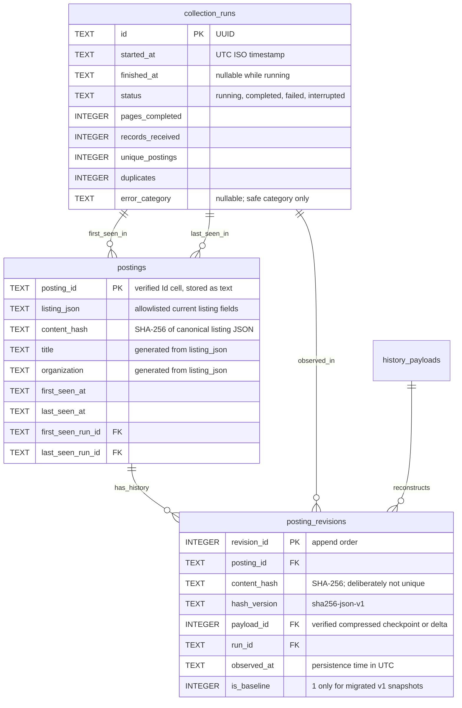

# WaterlooWorks Flash Next

WaterlooWorks Flash Next is a Google-authenticated shared WaterlooWorks listing browser with explicit manual refresh, search, filters, and SQLite history. Manual refresh collects plain-text detail content after saving the full listing pass, then normalizes saved postings and runs bounded OpenAI-assisted extraction across the saved workspace. Individual posting pages read saved content, normalized analysis, history, and comparisons without fetching.

Any server-verified Google account may browse saved jobs. Only the operator-pinned owner (`WW_BOOTSTRAP_ADMIN_EMAIL` and/or `WW_BOOTSTRAP_ADMIN_UID`) can become the sole admin of an empty database; any other first sign-in is refused. Only admin can refresh. The signed-out app shell remains visible without loading protected data. See [Firebase setup, schema11 migration, HTTPS and acceptance gates](docs/firebase-auth.md).

## The idea

Instead of opening every posting to compare job details, students can browse a clearer, more searchable view of WaterlooWorks listings.

The wrapper aims to extract and organize information such as:

- **Salary:** Compensation amounts, ranges, and pay periods when available.
- **Keywords:** Technologies, skills, responsibilities, and other relevant terms.
- **Location:** Where a role is based.
- **Work arrangement:** Remote, hybrid, or in-person status.

Missing or ambiguous details should be clearly marked rather than presented as confirmed facts.

## Planned workflow

1. Fetch the latest postings from WaterlooWorks through an authorized access method.
2. Analyze each posting and normalize its key fields.
3. Present the results in an easy-to-scan interface with search and filtering.
4. Link back to the original posting for full details and applications.

## Compensation sorting

The sort menu offers Compensation: Average, Minimum, and Maximum. Every posting card shows compact pay (or `--/--` when unavailable), independent of sorting. Weekly/monthly/yearly amounts are converted to estimated hourly equivalents using stated weekly hours, or the owner-approved fallback of 40 hours/week, with 52 weeks/year (12 months/year). The Options card below Filters selects Hourly/Monthly and Original/Approx. CAD/Approx. USD display, persisted locally. Pay rows show only the value, without explanatory captions. Values and counts use comma grouping; source text and posting IDs remain unchanged. Daily rates remain daily because weekly hours do not establish hours/day. In compensation sorts they are unrankable and appear after comparable hourly/monthly pay, never ahead merely because “day” sorts alphabetically before “hour”. Source rates remain unchanged in posting details. Approximate currency conversion uses dated Bank of Canada reference rates from an on-demand, bounded server request; unsupported known currencies stay original. Unspecified source currency is displayed as assumed CAD with an asterisk, such as `40 CAD/hr*`; the marker survives conversion (for example `USD/hr*`) and never invents a missing pay period. Values sort highest first within the resulting currency/pay-period groups. Average is exactly `(minimum + maximum) / 2`, not a weighted average. Multiple eligibility tiers use their outer bounds; the original tiers remain visible in details. For sorting only, missing salary counts as zero (tied with explicit zero and below positive pay), and unspecified currencies default to CAD before currency conversion and tier aggregation. These defaults do not change stored evidence. Currency assumptions in displayed amounts are explicitly marked with `*`. Missing endpoints are not invented; unknown periods or incompatible rates still sort last. Ranking uses only source-current, validated pay and is a display calculation, not a new source fact. Older running APIs keep these options disabled until safely restarted; an active collection/extraction must not be interrupted for deployment. While a pay sort is active, the method summary sits in a collapsed HeroUI `Disclosure` (“How pay sorting works”) above the results instead of an always-visible paragraph.

Salary reads also recover unambiguous ISO currency codes adjacent to an exact amount span (including a trailing parenthesized code). Work-week-hour spans are excluded from salary candidates and marked as partial output; a single explicit weekly schedule can supply weekly hours. These evidence-based corrections do not modify immutable extraction records or guess a source currency from location or a bare dollar sign.

### Salary color bands

Salary text uses the highest known rate across a posting's tiers, normalized to CAD/hour: under20 neutral;20–<30 green;30–<40 blue;40–<50 gold;50–<65 purple/bold;65–<80 red/bold/italic;80+ additionally underlined. Colors do not change displayed amounts or currencies. Period conversion uses stated weekly hours or the existing40-hour fallback. Dated FX is requested when saved foreign-currency rates need classification, including Original display mode. Missing maxima (including lower-bound-only rates), unknown periods, daily rates, unavailable FX for known foreign currencies or disputed pay remain neutral. Unspecified currency defaults to CAD for color classification, matching sorting; source values remain unchanged and display assumptions carry `*`. This salary-text-only styling exception was explicitly approved; no new custom React component was added.

## Reload performance

The local API keeps one in-memory serialized workspace and one keyword-index snapshot. Persistent read-only SQLite observers invalidate them when the trigger-maintained `data_generation` counter moves (any insert/update/delete on a saved-data table, from any process) or the file is replaced; sign-ins, logouts, credential/usage writes and run heartbeats do not invalidate them. If the trigger set is incomplete, the observers fall back to invalidating on any commit. A write during assembly prevents caching that result. Loads are serialized per snapshot to avoid duplicate work. Responses remain private, and GETs still do no collection/inference. Gzip compresses large responses without compressing or buffering SSE. The browser defers startup one microtask to avoid sending a doomed request during React development-mode effect cleanup. Initial server reads and first worker preparation still take longer than subsequent reloads.

## Local model benchmark

Run `npm run benchmark` to test the currently loaded LM Studio model against private saved-source cases. It uses the OpenAI-compatible endpoint, selects supported reasoning settings, and reports **salary extraction and technical-keyword metrics separately**. `npm run benchmark -- --dry-run` checks setup without generation. See [benchmark usage and dataset format](benchmarks/README.md). Code and generic prompts are tracked; real postings, reference annotations and results remain Git-ignored.

## Keyword coverage and Similar jobs

`npm run benchmark:coverage` measures the reusable weighted keyword-coverage function on one saved posting's original text against100 randomly selected, source-current indexed postings. Weights use `log(1 + source occurrences)`; matching each keyword earns its weight once. It reports preparation, first-pass and warmed scoring time separately, with private reproducibility artifacts. Similar jobs uses this directional, explainable coverage—not verified suitability—to show the top12 positive matches, excluding the current posting. Scores and matched/missing keyword breakdowns stay internal; cards show the suggested posting's details. A dedicated browser worker caches profiles and revalidates the source-current index on navigation; description loading does not wait for recommendations. See [algorithm and benchmark details](docs/keyword-coverage.md).

## Location and work arrangement

List cards, posting details and Similar jobs show a location pin, a small rectangular country flag when available, and the location text. A small HeroUI chip beside the location shows **Remote**, **Hybrid** or **In-person** only when that exact arrangement is present in current saved detail fields. Missing or ambiguous arrangements have no chip; no inference or network refresh is triggered. The workspace API exposes the nullable `work_arrangement` value, read in bulk within the existing source snapshot. Chips wrap naturally on narrow layouts.

## Backend stack

- **Python + uv:** Backend development, dependency management, and environment setup.
- **Pydantic:** Typed data models and validation for job postings and extracted fields.
- **Playwright:** Browser automation for complex scraping flows.
- **Direct HTTP requests:** Fast data retrieval where browser automation is unnecessary.

Prefer direct requests when practical, using Playwright for browser interaction and authentication. The listing collector currently uses Python's standard-library HTTP client; per-posting retrieval remains to be implemented.

## Data schematic (observed so far)

This describes the fields observed during guided exploration and the current core/export mapping—not a finalized API contract. No mock postings or sample values are included.

```text
Paged listing response
├── totalResults: integer
├── page: integer
└── data: row[]
    ├── id: platform row identifier (not used by the collector)
    └── data: cell[]
        ├── key: field name
        └── value: JSON value (type depends on the field)

Collected listings
└── keyed by posting ID from the "Id" cell
    └── listing row, retained in memory

Private JSON export
├── exported_at: UTC timestamp string
├── complete: boolean
├── pages_completed: integer
├── records_received: integer
├── unique_postings: integer
├── duplicates: integer
└── postings: exported listing[]
```

### Listing fields and export mapping

| Observed source field   | Export field        | Meaning / current handling                                     |
| ----------------------- | ------------------- | -------------------------------------------------------------- |
| `Id`                    | `id`                | Posting ID; normalized to a string and used for deduplication  |
| `JobTitle.postingTitle` | `title`             | Title extracted from the `JobTitle` cell's object value        |
| `Organization`          | `organization`      | Organization name                                              |
| `Division`              | `division`          | Organization division                                          |
| `Openings`              | `openings`          | Number of openings as supplied                                 |
| `City`                  | `city`              | Listed city/location text                                      |
| `Level`                 | `level`             | Posting's level field                                          |
| `ApplicationCount`      | `application_count` | Application count as supplied                                  |
| `Deadline`              | `deadline`          | Display deadline as supplied; not yet normalized to a datetime |

Apart from ID and title handling, exported values retain their source JSON types; numeric/date normalization is not applied to storage or export. The frontend separately derives validated numeric ordering and deadline countdowns. Fields absent from a row are omitted, not invented.

Other observed cells: `postingId`, lowercase `deadline`, `canApply`, `hasApplication`, `online`, and `apply`. The `JobTitle` object also contains `new`, `featured`, `applied`, and `viewed` flags. These are **not exported**. `postingId` is distinct from the row-level `id` and the `Id` cell; their equivalence has not been established.

### Per-posting detail response (exploratory only)

Clicking a title produced two POSTs with `action` and `postingId`: one returned JSON metadata, the other markup. The metadata contained:

- Strings: `div`, `internalStatus`, `org`, `position`, `status`.
- Integers: `id`, `divId`.
- Boolean: `hasPreScreening`.
- Objects: `applicationData`, `geoData`.
- Arrays: `defaultLocations`, `tags`.

Nested metadata objects remain unmodeled. Detail extraction saves reviewed label/value text, including source compensation and work-arrangement wording, without raw HTML or request/session attributes. Deterministic normalized analysis is stored after manual refresh or an explicit offline command and exposed through read-only analysis/history/comparison APIs and posting pages alongside the original plain-text content.

## SQLite storage model

Schema v14 uses Python's built-in `sqlite3` and Pydantic's `StoredListing` model in `backend/src/waterlooworks_flash_next/database.py`. The private local database is **`data/waterlooworks.sqlite3`**; the entire `data/` directory, including WAL files, is excluded from Git, formatting, and Docker build contexts.



- **`collection_runs`:** Collection-level provenance and counters. Completed/failed/interrupted runs require a finish timestamp. Counts must be nonnegative, and records must equal unique postings plus duplicates. Never store exception text, credentials, cookies, or request templates.
- **`postings`:** One latest listing snapshot per posting ID. `listing_json` uses the export field names above and rejects extra root keys. It preserves unnormalized JSON types for fields such as openings, level, and deadline; missing fields are distinct from explicit nulls. Title and organization are generated, indexed columns for search.
- **`posting_revisions`:** Append-only revision events with compact payload reference, hash, run reference, and observation timestamp. SQL triggers reject updates/deletes. Order by `revision_id`; use verified reconstruction to compare adjacent snapshots.
- **Change detection:** `sha256-json-v1` hashes compact UTF-8 JSON with recursively sorted object keys. Object key order and formatting do not create changes; array order, field values/types, and missing versus explicit null do. Run IDs and observation timestamps are excluded; all allowlisted listing fields—including application count—are included. NaN/Infinity are rejected. This is change detection, not encryption or tamper-proof auditing.
- **Repeat observations:** First observation creates a revision. An identical current hash updates the latest snapshot's last-seen metadata and appends a per-run observation without another revision. A changed hash appends a revision and updates the current snapshot atomically. Reverting to an earlier hash creates another revision, so history does not collapse reversions.
- **Relationships:** First/last-seen runs and revision run references are protected by foreign keys. No deletion/inactive state is inferred from absence. Unchanged observations are not separate revisions; schema v5 retains every newly saved run-to-posting membership.
- **SQLite settings:** Transactional upgrades through v14 (`user_version=14`), STRICT tables, JSON checks, foreign keys, WAL mode, and a five-second busy timeout. Existing v1 snapshots become marked baseline revisions at their last-known observation; earlier changes cannot be reconstructed. Requires SQLite 3.37+ with JSON support. Newer schemas are rejected rather than downgraded.
- **Core API:** `open_database(path)` initializes/migrates the database; the caller closes it. `start_collection_run(connection)` creates empty run metadata only. `save_listings(connection, run_id, listings)` takes validated `StoredListing` objects, saves a batch in one transaction, and returns the number of new revisions. It requires a running run, rejects duplicate IDs within a batch, and does not commit a caller's pre-existing transaction. Run counters/finalization remain the caller's responsibility.

**Scope:** Listing refresh is wired through a local FastAPI API to SQLite and listing history. Sequential detail-content collection follows the completed listing save. Per-posting content checkpoints survive later failures. After successful collection, manual refresh explicitly normalizes all saved detail content and runs bounded OpenAI extraction with validated-cache reuse. Startup and GET requests never start analysis. Tests cover schema/migration behavior and API safety without invented postings. A single authorized live API run persisted 1,216 postings. Populated listing/content migration and revision lifecycles are verified offline on private backup copies; production migration and live refresh verification remain separate gates. No private postings or mock data are seeded. Use local disk, restrict filesystem access, and back up SQLite consistently (including WAL state); this database is not encrypted. Future Docker access requires a runtime volume, never image contents.

### Per-refresh observations (v5)

`posting_observations` is append-only with integer `observation_id`, unique `(posting_id, run_id)`, immutable listing `revision_id`, `observed_at`, and `timestamp_provenance`. Every successful full listing save records each posting, including unchanged application counts. The revision reference preserves raw application count, openings, and deadline types and missing/null distinctions without copying listing JSON or descriptions. Numeric projections are deferred; unknown or invalid counts must never be treated as zero. Nonfinite JSON is rejected on save.

New refreshes pass per-posting page receipt timestamps (browser response-end timing for page one, full-body receipt for direct HTTP pages), normalized to UTC with six fractional digits. First-wins deduplication retains the matching first receipt. Run start/finish and revision persistence times remain independent real instants. Compatible `save_listings` callers may omit `received_at`; those observations are explicitly `persistence_fallback`, not invented response times. Supplied mappings must cover the exact batch with timezone-aware datetimes. Identical posting/run replays are no-ops; conflicting replays fail atomically.

The transactional v4-to-v5 migration retains every existing table, source history, FK, and trigger. It backfills only the last actual revision per posting/run, marked `legacy_persistence` or `legacy_baseline`, retaining original timestamp strings. It does **not** reconstruct unchanged historic refresh membership. Baseline observations represent only a migrated last-known snapshot. Read-only `observations.observation_series` joins raw revision evidence, ordered by immutable observation ID even when timestamps tie; no new public endpoint or UI is added. Failed/partial listing passes do not save observations or imply unavailability.

### Compact reversible history (v6)

Listing and content revision events now reference immutable `history_payloads`, deduplicated by history kind and canonical hash. Reversions still append distinct revision events and observations, but reuse the verified earlier payload state. Current `postings.listing_json` and `posting_contents.content_json` remain full snapshots for fast reads. Metadata-only detail history is unchanged.

Payloads use versioned zlib-compressed canonical JSON checkpoints or reversible object/text deltas, whichever is smaller after compression. Object patches distinguish add/remove/null and preserve numeric types; arrays/scalars are exact replacements. Text patches use linear common-prefix/suffix splices, never quadratic text matching. Reconstruction verifies checkpoint and before/after delta hashes, with at most 32 deltas between checkpoints. Snapshots over 1 MiB always use compressed checkpoints. The codec rejects nonfinite JSON, excessive nesting, malformed patches, truncated/trailing compressed streams, and size-limit violations (64 MiB snapshots/encoded chains, 4 MiB patches); the reader cache is limited to 16 MiB. Hashes detect corruption, not malicious rewriting of all evidence.

The transactional v5-to-v6 migration verifies every listing/content revision, retains revision IDs/order/run links and observation/attempt references, and **removes** the old revision `listing_json`/`content_json` columns rather than retaining shadow copies. Internal SQL consumers must use `compact_history.revision_snapshot` or `HistoryReader`; the workspace API and observation helper retain reconstructed snapshot contracts. Required payload/hash/current-state checks replace the affected insertion triggers; append-only triggers remain. Unknown dependent schema objects or invalid evidence abort and roll back the migration. Older versions chain through the existing migrations.

Compaction frees space for SQLite reuse but does not automatically shrink the physical file; migration also needs temporary free disk space. Back up consistently before deployment. `VACUUM` is an explicit offline maintenance decision, never a GET, refresh, or migration side effect. Reconstruction/restoration means reading faithful history, not modifying WaterlooWorks or deleting later revisions.

### Normalized deterministic projections (v7)

`analysis_projections` identifies immutable output by posting, exact listing/content revision IDs and hashes, parser version, and a separate producer identity/version. `posting_projection_current` selects only a deterministic projection whose source revisions still match the current saved posting. SQL guards reject stale source pointers and prevent model provenance from inserting or replacing fixed/application output.

Fixed fields are queryable columns with separate arrangement and geographic values; levels, targeted disciplines, canonical skills/mentions, compensation rates, application instructions, and classified links use indexed child tables. Decimal pay bounds and hours are canonical text to retain exact precision. Null currency/period remain unknown, payout frequency is independent, and rate ordinals plus nullable eligibility evidence support later validated multi-tier model output without seeding any model result.

Raw field values and instruction text are not copied into analysis JSON. Evidence rows retain source kind/field/hash and bounded spans against immutable compact revision history; `normalized_storage.restore_field_evidence` and `restore_source_span` reconstruct exact evidence. `normalize_saved_posting` commits one posting atomically and idempotently. `normalize_saved_postings` and `python -m waterlooworks_flash_next.normalized_storage <database>` are deliberate offline entry points for already saved rows; they perform no collection, authentication, network request, model generation, startup hook, GET analysis, API change, or UI change.

### Conservative WaterlooWorks pacing

Every WaterlooWorks HTTP request in a refresh (listing pages, detail markup and the first-posting bootstrap metadata/markup reads) passes through one shared, strictly sequential pacing gate per run:

- **Gap:** a uniformly jittered 3–6 s wait between the completion of one request and the start of the next. Requests never overlap.
- **Rest breaks:** after every 20–30 requests (jittered) the gate rests 45–120 s; progress shows a `listing_rest`/`detail_rest` stage ("resting to stay polite to WaterlooWorks"). No rest is taken inside the two-request bootstrap.
- **Per-run cap:** `WW_REFRESH_REQUEST_CAP` (default 400, 1–2000). Reaching it stops cleanly before the network: fetched pages/details are saved, the run finishes as completed with `pacing_stop=request_cap`, and the remaining postings wait for the next refresh. Postings without saved detail content are queued first, so capped runs make progress across refreshes.
- **Rolling 24-hour cap:** `WW_REFRESH_DAILY_REQUEST_CAP` (default 1200, 1–5000), counted per run in SQLite (`collection_run_pacing`, schema v15). Sign-in and job-board browser loads are counted conservatively (4 per run). A refresh is refused with HTTP 429 and the remaining time when the budget cannot cover a run; a running refresh stops cleanly with `pacing_stop=daily_cap`.
- **Minimum interval:** `WW_REFRESH_MIN_INTERVAL_MINUTES` (default 30, 0–1440) after the previous run's finish. A scheduled slot inside it is skipped (`skipped_blocked`). An admin manual refresh inside it is not refused outright: `POST /api/refresh` with `{}` answers HTTP 409 with the fixed `X-WW-Refresh-Recent: <previous finish, UTC ISO>` header, the UI asks “Refresh again?”, and only `{"confirm_recent": true}` proceeds. Ban-risk/rate-limit blocks and the rolling budget stay hard HTTP 429 refusals with `Retry-After` that no confirmation overrides; when both apply the hard refusal wins.
- **Fail fast:** HTTP 429 stops the whole run at once (no retry) and blocks refreshes for max(Retry-After, 1 h). HTTP 401/403, a mid-run redirect to a sign-in/SSO/Duo page, or a captcha/"unusual activity"/rate-limit or sign-in page body stops at once and blocks refreshes for 6 h. These are reported as **ban-risk** stops (`pacing_stop=ban_risk`, a critical "BAN RISK" log line and an Admin settings alert). A single transient timeout/5xx is retried once after at least 30 s; if that retry fails too, the run stops and blocks for 6 h (stricter than three consecutive failures). Retries count against both caps.
- **Sign-in:** at most one login attempt per run; a failed login ends the run and never loops. The persistent browser profile is reused, but every run still performs the explicit sign-in flow (no session-reuse shortcut was added).
- **Manual or scheduled:** the admin starts a refresh, or the optional scheduler below starts one at an admin-chosen time through the exact same guarded path. Blocks are cleared only by the operator: `python -m waterlooworks_flash_next.rate_limit clear --database <path>` (stop the API first).

All three variables are server-only and validated strictly: a missing variable uses the safe default; an empty, non-integer or out-of-range value fails startup with a fixed message (never unlimited). Admin settings › Refresh shows the policy, rolling usage, next allowed refresh time, any active block and the last run's early-stop reason.

### Scheduled refresh (schema v17)

Admin settings › Schedule (admin only) holds up to 24 daily Toronto wall-clock times, shown sorted in 12-hour form, and a persisted on/off switch (off after migration). A new time must differ from every existing one by at least `WW_REFRESH_MIN_INTERVAL_MINUTES`, measured around midnight; duplicates and malformed values are refused with fixed messages that never echo input. Routes: `GET/POST/DELETE /api/admin/refresh-schedule` (`{"time":"HH:MM"}`) and `PUT /api/admin/refresh-schedule/enabled` (`{"enabled":true}`), all admin-only, no-store and behind the usual Origin/JSON/`X-WW-Request` guards.

- **Server gates:** the scheduler task runs only for the environment database with `WW_ENABLE_REFRESH=1` **and** `WW_ENABLE_SCHEDULE=1`; it is cancelled at shutdown. Without both, saved times and the switch are kept but nothing fires, and the tab says so. (The current Compose file does not pass `WW_ENABLE_SCHEDULE`; add it to the backend environment when deploying.)
- **Same protections:** about every 30 s the scheduler claims each due slot (`refresh_schedule_slots`, primary key = Toronto date + HH:MM) with one INSERT, so restarts or several workers never fire a slot twice, then calls `RefreshService.start` exactly like `POST /api/refresh`: the provider lease, shared pacing gate, per-run and rolling caps, minimum interval, ban-risk blocks and credential/AI readiness all apply; the scheduler never sends `confirm_recent`, so the minimum interval stays a hard skip for scheduled slots. A refused slot is recorded as `skipped_running`, `skipped_blocked`, `skipped_disabled` or `failed_to_start` and never retried. Each decision logs one fixed line.
- **No catch-up:** a slot fires only within 10 minutes of its time and only if it came due after scheduling was last switched on; missed slots (downtime, a disabled period) are skipped. DST: a nonexistent spring-forward time fires once at the shifted instant (02:30 → 03:30 EDT); a repeated fall-back time fires once, at its first occurrence.
- **Duo:** every run performs the explicit sign-in, so a scheduled run may send a Duo push to the account owner when WaterlooWorks needs a login. Approve only pushes you expect; the code appears in Admin settings › Refresh.
- **Auto-off:** if a scheduled run fails sign-in or Duo (denied, timed out, not completed, credentials), or ends on a ban-risk signal (429, 401/403, a mid-run login/SSO/Duo redirect, a challenge page, any refresh block), the switch turns off atomically and records the run, slot and a fixed category. Ordinary skips, network/timeouts and request caps do not. The Schedule tab shows a danger alert with the latest in-memory run log; members see only "Scheduled refresh at … failed. Please ask an admin to check the log." Switching it back on clears the alert; slot history is kept.
- **Header:** everyone sees "Refreshed 3 hours ago · Next in 5 hours" (exact Toronto times in a focusable tooltip). The shared refresh snapshot exposes only `next_scheduled_at` and `scheduled_failure.failed_at` to members.

### Explicit inference (v8 storage; schema16 Pi sidecar)

All AI inference runs on the Pi harness: a disposable Node sidecar
(`inference-sidecar/`, pinned `@earendil-works/pi-ai` and
`@earendil-works/pi-agent-core` 1.1.0) runs one fresh tool-using agent per
posting while the backend stays authoritative for selection, prompts,
validation, budgets and writes. The admin picks one access mode in **Admin
settings → AI** — OpenAI API key, Sign in with ChatGPT (manual paste),
Codex device login (unofficial) or a custom OpenAI-compatible server — and
explicitly activates it; saving never calls a model. See
[architecture, modes, safeguards and commands](docs/pi-inference.md).

`python -m waterlooworks_flash_next.inference <database> start --posting-id <id>` explicitly runs a job of selected saved postings (up to 10,000) with the active configuration. Use `start --all` instead of `--posting-id` to select the whole saved workspace after explicit normalization. The CLI prints the job ID before inference so another terminal can inspect or stop it. `status`, `stop`, and `resume` are explicit commands. Manual Refresh creates an extraction job after collection and normalization over the saved content of postings in that run's listing pass (not the whole history), split into jobs of at most 10,000; the first job ID equals the refresh run ID for durable status/recovery. Startup and GET requests never create or resume jobs. Work is checkpointed per posting with the configured number of parallel streams (default 1) and no automatic paid retry. An expired running lease is reported interrupted and requires `resume`; stop prevents new requests without claiming cancellation of an in-flight completion.

Every model turn reserves a ledger attempt first and records its usage after. API-key mode keeps the USD stops (`WW_OPENAI_REQUEST_LIMIT`, default 20 requests per run, now counted per model turn; `WW_OPENAI_KNOWN_COST_STOP_USD`) — not a guaranteed cap. Subscription and custom modes record a known $0 with token usage and are bounded by the configured requests per run. Unknown usage or exhausted limits can leave analysis incomplete. The historical provider notes are in [docs/openai-provider.md](docs/openai-provider.md).

Only source-grounded validated pay rates and new skill mentions become immutable model-provenance children. Complex pay supports fixed/range/open bounds and exact eligibility tiers; explicit currency/period/hours/payout evidence is required, while unknown currency/period remains valid. Benefits, stipends, equivalents, unsupported guesses, negated skills and ungrounded requirements are rejected atomically. Raw prompts, responses and reasoning are never stored. A content-hash view hides stale model pointers after descriptive source changes. Read-only posting APIs/UI display accepted current-version model pay and skills separately from deterministic facts; stale content or obsolete validation versions are not used. Manual Refresh is the explicit provider-running UI action; the local CLI/functions remain available. Refresh covers every saved posting with detail content, skips postings without saved details and parser-complete work, and reuses validated caches. Progress reports processed/accepted/rejected/failed/skipped/cache-hit counts without private source text or reasoning. A missing activated AI configuration, credential or sidecar fails refresh admission before collection; later provider failures preserve saved checkpoints without automatic resume. The refresh single-flight lock remains held through analysis. To stop extraction, use `python -m waterlooworks_flash_next.inference <database> stop <refresh-run-id>`; in-flight calls finish before it stops.

### Source-grounded index checkpoints (v9)

`npm run extract -- status|stop` still reads historical runs; its paid `start`/`resume` path used the removed OpenAI Responses bridge and has no Pi port (Pi extraction in Refresh covers pay and skills). It does not refresh, load models, or resume automatically. Additive `source_extraction_*` tables retain run ownership, per-slice checkpoints, source-current immutable technical names and exact-decimal pay candidates. Evidence uses Unicode-code-point spans into existing source revisions, not copied descriptions or model reasoning. Existing normalized pay/skills projections remain unchanged in storage. The read-side integration now deliberately uses selected source-current accepted pay for detail, listing and Similar jobs compensation, and exposes broader terms as keywords rather than applicant requirements. See [saved enrichment authority](docs/local-api.md#saved-enrichment-authority) for precedence, freshness checks and limitations. See [benchmark methodology, results, stop/resume commands and storage caveats](benchmarks/README.md). Back up consistently before upgrading; older running APIs must be restarted to recognize schema 9.

An experimental `--shared-job-prefix` extraction profile places complete canonical job details before task-specific alias maps and runs each posting's slices sequentially. It is opt-in: default v7 requests/scheduling and standalone country scanning are unchanged. Source/configuration cache checks and exact evidence validation remain mandatory. See [shared-prefix usage, compatibility and pending live acceptance](docs/inference-prefix-caching.md); matching prefixes do not guarantee provider KV retention.

### Inferred work country (v10)

`uv run --project backend python -m waterlooworks_flash_next.country_runner <database> start --all` explicitly predicts job work country with the active Pi configuration from saved location/context, separately from verified source facts and salary/keywords. Schema10 adds checkpointed `country_inference` metadata; both listing and content hashes must remain current. Cards, At a glance and Similar jobs display local MIT `flag-icons` SVGs through unmodified HeroUI Avatar composition, with country name and an inferred disclosure. The fifth card row has an unknown placeholder when no accepted prediction exists. Country filtering is explicitly inferred; broad search includes accepted names/codes. Unknown, ambiguous, multi-country and low-confidence locations never default to a country. Confidence is model-reported, not a calibrated accuracy probability. Country never determines pay currency. See [contract, safeguards, migration, pilot and stop/resume commands](docs/country-inference.md). Production inference and visual acceptance remain explicit owner gates; no GET/startup/SSE model calls are added.

### Detail model and independent history

The database also contains **`posting_details`**, **`posting_detail_revisions`**, and **`posting_fetch_attempts`**, linked by the same posting ID. Details use separate hashes from listings. Changed content and reversions append revisions; unchanged successes reference the current revision. Failed fetches never replace valid data.

Strict detail metadata models cover title, organization/division, division ID, status/internal status, and pre-screening flag. The legacy v3 metadata contract keeps its reserved body fields **null-only**. The v4 `posting_contents`, `posting_content_revisions`, and `posting_content_attempts` tables independently hold `content_only` snapshots with reviewed plain-text labels/values, canonical hashes, provenance, and durable attempt counters. Metadata is never invented to satisfy a required field.

See **[the complete posting model](docs/posting-model.md)** for v3 metadata and v4 content relationships. The v4 migration preserves all v3 rows, constraints, and append-only triggers; metadata/content unification is not implemented. Default refresh covers the full current listing-derived detail queue. No background stale-data refresh or automatic resume is introduced.

## Frontend stack

- **React + Vite:** Frontend UI and development/build tooling.
- **HeroUI v3:** UI component library.
- **Framer Motion:** Animations and transitions.
- **React Icons:** Lucide icons for fields and controls; no custom HeroUI style overrides.

## Local application

- **Posting cards:** stronger title, building icon + company, hash icon + posting ID beside a quiet deadline label (colored Chips when urgent), a divider, then five stacked pay/location/inferred-country/application/opening rows; 18 cards per page. Building/pin/hash icons replace redundant visible field labels but retain accessible names. People/calendar icons accompany correctly pluralized counts.
- **Search:** case-insensitive partial-word matching across posting ID, title, company name, and saved location/city/country. Every whitespace-separated query word must match at least one of those fields, so words can span fields in any order. Missing/non-text values are ignored. Applied after 125 ms of idle typing; clearing applies immediately. Existing filters still narrow the results.
- **Filters:** a slightly wider HeroUI card with outer shadow clearance contains Organization, Country, City (the stored location), and Targeted disciplines, with a Clear button that resets filters without clearing the search query. Each filter button's accessible name is its visible label plus its visible value (for example “City All cities”), never a replacement `aria-label`, so voice-control users can say what they see. Unselected controls and labels are neutral/muted; selected controls receive subtle emphasis through documented HeroUI props. Smaller centered HeroUI modals show searchable checkbox lists grouped under selectable A–Z and Others headings with leaf-option counts, one indented option per row. Targeted disciplines uses exact saved source values grouped by faculty (combined prefixes stay combined) or Themes and explicit theme subcategories; unknown prefixes stay in Others. Category checkboxes show partial selection and select/clear all logical descendants, not just mounted rows. Search matches categories and full leaves; “Select all matches” affects only matching descendants and preserves other selections. Compact 40px rows use viewport-sized buffered virtualization without pagination. Scroll measurements are coalesced per animation frame, existing HeroUI rows are memoized, and scrolling state is isolated from the workspace. HeroUI ScrollShadow handles scrolling. Search keeps modal dimensions stable and retains selections. Closing preserves the modal content until its exit animation finishes. Apply commits, Cancel discards, and Clear selection resets the draft. Selections are OR within each filter and AND across filters. Options come only from stored data; Country (inferred) uses accepted source-current country predictions and stays disabled when none are available.
- **Manual refresh:** neutral while idle, subtly emphasized while active; an explicit action with sanitized SSE logs and page progress. One run at a time and the shared WaterlooWorks pacing. Pressing Refresh within the minimum interval after the last finish opens a HeroUI alert dialog (“Refresh again?”, how long ago the last refresh finished, Cancel / Refresh anyway) before anything is sent; the admin pacing status is read first, and a server 409 with `X-WW-Refresh-Recent` (stale client) opens the same dialog. Only Refresh anyway sends `confirm_recent`. Blocked/daily-budget and running clicks show top-centered explanatory toasts without another POST, and server 409/429 race responses are handled the same way; there is no countdown. Offline, disabled-server, and request-in-flight guards remain. Loading/reconnecting never starts scraping.
- **Progress:** stage, page/record/duplicate counts, and an approximate client ETA seeded from the collector estimate. The display drops one second every 1,200 ms between samples and resets to each completed page's latest collector estimate, including upward revisions. When a sample expires, it shows “Updating ETA…” rather than remaining at one second or implying completion. Unestimated stages and retries show unavailable; a new run resets the countdown. Details keep the stable “Fetching posting details” label and their own completed/total/request/retry/burst counters. Their approximate local ETA uses newly observed detail completions and elapsed time, including rests and retries, never the listing estimate. It shows “Estimating ETA…” until two completions and two seconds are observed, starts fresh after reload, and grows during stalls rather than counting down. Waits and a server verification cap are visible. The API's `eta_seconds` remains the unchanged collector estimate. Log messages appear only in the console, not repeated below the progress bar.
- **Focused layout:** follows HeroUI's semantic hierarchy and progressive disclosure: compact header, desktop filter sidebar (a balanced 2×2 filter grid on tablet widths), search-first mobile order, and title-focused cards. At phone widths (≤40rem) the filters and options collapse into one full-width “Filters (n)” button that opens a HeroUI bottom `Drawer` with full-text filter triggers, and the results fill the remaining viewport instead of a forced 64rem page. No summary tiles; individual posting pages expand within the workspace. Listing history is retained in SQLite, not shown as an individual view. HeroUI skeleton cards mirror the header, title, company, ID/deadline row, divider, and five icon/detail rows before crossfading into loaded cards; reduced motion disables animation. The results fill remaining viewport space and scroll through HeroUI ScrollShadow with the scrollbar hidden. Page changes scroll smoothly to the top unless reduced motion is requested. Total count, current/total pages, and the number shown on the current page share one status line; only filtered listings are called results.
- **Sort by:** default (posting ID ascending), recently added, time remaining, most applications, most openings, and organization. Applied before pagination; changing sort returns to page 1. Recently added uses local `first_seen_at`, not source publication dates. Unknown counts sort last; ties use posting ID. Time remaining puts upcoming deadlines nearest-first, then passed deadlines most-recent-first, then unknowns.
- **Deadlines:** the verified abbreviated-month/12-hour display format is interpreted in `America/Toronto` using `@internationalized/date`. Waterloo's [official recruiting schedule](https://uwaterloo.ca/co-operative-education/important-dates) explicitly labels “Job postings close (ET)”. Day/hour countdowns update every minute and on tab return; the original value remains unchanged and is shown in a HeroUI `Tooltip` whose focusable trigger is also reachable by keyboard (its accessible name starts with the visible countdown and includes the exact Eastern Time deadline); touch users see the exact deadline inline on the posting page. Invalid dates, unsupported formats, and ambiguous/nonexistent DST times stay unknown. “Deadline passed” does not claim the source posting is closed. Over three days uses muted regular text; one–three days uses soft amber; under 24 hours uses soft red, and under one hour uses the strongest red variant.
- **Hierarchy and contrast:** documented HeroUI typography and semantic color props make titles larger/stronger and metadata quieter—no opacity or component CSS overrides. Following [W3C text contrast guidance](https://www.w3.org/WAI/WCAG21/Understanding/contrast-minimum.html) and [NN/g hierarchy guidance](https://www.nngroup.com/articles/visual-hierarchy-ux-definition/), rendered card text was measured in both themes: minimum 4.83:1 light and 6.75:1 dark (above the 4.5:1 ordinary-text threshold). This is not a full accessibility audit.
- **Approved custom pagination wrapper:** `frontend/src/app/App.tsx` and `frontend/src/styles/index.css` contain the explicitly user-approved floating outer panel because HeroUI's Card has no padding/blur props. Its intrinsic width follows the page links; background uses 55% surface color and 24px backdrop blur. The HeroUI pagination controls themselves remain unmodified. This exception does not authorize other component CSS overrides.
- **Console:** appears for an observed active refresh as a clickable three-line preview, without a separately styled button. HeroUI's unstyled disclosure trigger retains keyboard/focus semantics; expanding shows timestamped monospace logs up to the existing viewport-relative height cap. Three seconds after completion, failure, or interruption it fades and collapses smoothly, moving the content below without a final gap jump; reduced motion is immediate. Old terminal runs do not flash on page load. Displays the latest 200 reviewed entries with muted timestamps/debug text, blue INFO, amber WARNING, and red ERROR/CRITICAL severity labels using unmodified HeroUI components. Critical entries use a stronger filled badge. Messages remain escaped plain text; secrets and private diagnostics remain excluded. Expanded logs follow new entries only when already at the bottom. Scrolling up pauses following; “Jump to latest” resumes it.
- **Posting layout:** desktop pages use an At a glance sidebar, a central column of titled source cards with dividers (no description tabs), and a Similar jobs sidebar. Similar jobs ranks all usable source-current keyword profiles by descending weighted coverage rather than the legacy eligibility rules; ties use posting ID. Zero/unavailable scores are excluded and partial indexes are marked; percentages and keyword breakdowns are not displayed. Related metadata is grouped into compact Position details, Work term, Location, Compensation & benefits, Application details, and Organization cards; long narrative sections stay separate. Desktop columns use HeroUI ScrollShadow with hidden scrollbars and keyboard scrolling. Column headings stay outside their scrolling content; the center header shows the company, job title, posting ID, and saved timestamp. Breadcrumbs return to the current postings filters/page. The left summary groups location and presents openings/applications side by side. Saved plain-text line breaks are preserved, but original HTML emphasis/list structure and blank paragraph spacing were not retained by the collector. On narrow screens the description comes first in a normally scrolling stack. The loading skeleton uses the same responsive columns, headings and card layout, then crossfades simultaneously with the loaded content over 180 ms; reduced motion switches immediately. The approved custom SVG `frontend/src/app/ApplicationTrend.tsx` plots all saved numeric application-count observations (HeroUI v3 has no time-series chart). Unknown counts break the dashed connectors; no interpolation or new collection occurs. The 24-hour window ends at the latest saved observation, with net change over the actual covered interval or an unavailable state—not an invented daily total. Hovering selects the nearest saved point and shows its count and UTC timestamp in a HeroUI tooltip. Tapping or keyboard-focusing a point also opens it; Escape/outside taps dismiss it. No counts between observations are invented. Legacy timestamp provenance remains visible. Application history separately uses previous/next controls across changed application/opening/deadline states, preserving reversions and skipping consecutive unchanged observations. Controls are hidden when there is no change history. Analysis diagnostics are collapsed rather than displacing the description.
- **Stored job pages:** title links open `?job=<posting ID>` without a reload and preserve every browse parameter. Sidebar collapse and title/content crossfades expand detail content to the workspace width in a synchronized 180 ms transition with gentle content movement (no sequential waits or text scaling); reduced motion is live. Back restores the listing and clicked link/scroll; direct URLs, reloads, browser history, and new tabs work. Read-only `/api/postings/{posting_id}` returns the stored listing and latest allowlisted plain-text content/coverage/observation time, or explicit missing-content/null and missing-posting/404 states. Opening a page never fetches from WaterlooWorks; application information is text only.
- **Shareable view:** `q`, `page`, `sort`, and repeated `organization`, `country`, `city`, and `target` URL parameters restore the search query, pagination, sorting, and multi-select filters across reloads and Back/Forward. Defaults are omitted. Invalid pages/sorts are normalized; pages are clamped only after stored data loads. Unmatched filter values remain explicit and produce no matches rather than silently broadening the search. Links describe the view, not the data: recipients need access to the application and its authorized dataset. Transient dialogs/log state and credentials are not included.
- **Paper texture:** a local static `frontend/public/paper-grain.svg` supplies contrast-enhanced grain to the native body background in both themes, without altering HeroUI cards or controls.
- **Theme:** a HeroUI single-select `ToggleButtonGroup` (exposed as a “Color theme” radio group) with icon-only System/Light/Dark buttons using monitor/sun/moon icons; one choice is always selected. System follows OS changes; only the theme preference is saved in browser local storage, separate from shared URLs.
- **Brand mark:** the user-requested original SVG in `frontend/public/brand.svg` uses two concentric circular rings, each split into three blue arcs, with the inner ring rotated 60 degrees so their gaps alternate, inspired by the supplied WaterlooWorks favicon rather than the university crest. It appears to the left of the title; it is not an official WaterlooWorks logo. The user-requested custom `frontend/src/app/BrandMark.tsx` animation reuses that SVG geometry: during login/refresh the outer ring turns clockwise every 4.8 seconds while the inner turns counterclockwise every 3.2 seconds. It settles back to the original mark when work ends and stays static with reduced motion. Only the custom brand asset is animated; HeroUI controls remain unmodified.
- **API docs:** Swagger UI at `/doc` and machine OpenAPI at `/doc/openapi.json`, served only when the API process sets `WW_API_DOCS=1` (local development; never production). The tracked [`docs/openapi.json`](docs/openapi.json) is always available. Generated frontend types and CI drift checks keep the contract synchronized.
- **Agent API:** every signed-in user can reset, copy once and revoke a personal bearer token in settings; agents use it on `/api/agent/v1/` to search, filter, read and mark postings (interested/applied/not interested, viewed) on that user's behalf and to read when the listings were last refreshed and when the next scheduled refresh is due. It cannot start or schedule a refresh. See [agent API](docs/agent-api.md).

See [local API setup and safeguards](docs/local-api.md) and complete [Firebase configuration](docs/firebase-auth.md) first. HTTP development requires the explicit loopback-only auth exception. Start the API on loopback port 8787, then `npm run dev -- --host 127.0.0.1` for the frontend on port 5173 (or use `npm run dev --workspace frontend -- --host 127.0.0.1`). Vite proxies `/api` (and `/doc` when `WW_API_DOCS=1`); no cross-origin browser credentials are needed. **Production containers have been built and deployed on Linux ARM64; saved-data preservation, sandboxed Chromium, HTTPS/session guards and a bounded OpenAI pilot passed.** Real end-to-end refresh quality and Google/Duo acceptance remain separate checks. See [production boundaries and parent gates](docs/deployment.md).

## Proposed project structure

A single repository with separate backend and frontend applications, a local listings API, tests, and quality tooling. The tree below also includes planned modules; unimplemented directories and files will be added only when needed.

```text
waterlooworks-flash-next/
├── README.md
├── CONTRIBUTING.md
├── package.json             # npm workspace and shared quality commands
├── package-lock.json
├── .github/workflows/ci.yml # Frontend and backend quality gates
├── .gitignore
├── .dockerignore             # Exclude experiments, secrets, and local data
├── .prettierignore
├── .prettierrc.json          # Shared Prettier configuration
├── compose.yaml             # frontend dev / production SPA + private API
├── docs/
│   └── scraping-workflow.md # Verified Playwright navigation flowchart
├── backend/
│   ├── pyproject.toml       # Python dependencies, Ruff, and tool settings
│   ├── uv.lock
│   ├── Dockerfile          # Locked nonroot Python/Node/Playwright runtime
│   ├── src/
│   │   └── waterlooworks_flash_next/
│   │       ├── __init__.py
│   │       ├── login.py     # Browser startup and credential entry
│   │       ├── duo.py       # Duo branches and authenticated arrival
│   │       ├── jobs.py      # Board navigation and passive request capture
│   │       ├── listings.py  # Paced direct listing fetches and models
│   │       ├── listing_fields.py # Allowlisted saved listing columns
│   │       ├── database.py  # SQLite initialization and listing persistence
│   │       ├── detail_schema.py # Legacy v3 detail-table migration (tables kept, unused)
│   │       ├── logging.py   # Safe colored stage logs
│   │       ├── config.py    # Planned runtime configuration
│   │       ├── models/     # Pydantic data models
│   │       ├── scraping/   # Verified Playwright and direct HTTP flows
│   │       ├── analysis/   # Field extraction and normalization
│   │       └── services/   # Retrieval and analysis orchestration
│   └── tests/
│       ├── unit/
│       └── integration/    # Live access explicitly opt-in
├── frontend/
│   ├── package.json
│   ├── Dockerfile
│   ├── index.html
│   ├── vite.config.ts
│   ├── tsconfig.json
│   ├── eslint.config.js
│   ├── public/
│   ├── src/
│   │   ├── main.tsx
│   │   ├── app/            # App composition and providers
│   │   ├── components/     # Reusable UI built with HeroUI v3
│   │   ├── features/       # Feature-specific UI and logic
│   │   ├── lib/            # Shared utilities and backend integration
│   │   └── styles/
│   └── tests/
│       ├── unit/
│       └── integration/
├── tests/
│   └── e2e/                # Application-level end-to-end checks
└── .experiment/            # Always gitignored; never shipped
    └── test/               # Guided interactive Python exploration
```

- Keep scraping, analysis, and UI concerns separate. Promote verified experimental work into the backend rather than depending on `.experiment/` at runtime.
- Tooling: npm workspaces with a root `package-lock.json`, pytest for Python, Vitest and Testing Library for React, mypy for Python type checks, and GitHub Actions for CI. Explicit local browser verification uses Playwright; no live platform access runs in CI.
- Backend API: FastAPI + Uvicorn, with OpenAPI-generated frontend types. Listings and detail content are wired to SQLite v6; automated scheduling remains disabled.
- Private database files live under ignored `data/`; browser state must use an explicit private `WW_BROWSER_PROFILE` path. Production Compose provides separate private database and fresh browser-profile volumes; see [provisioning and recovery](docs/deployment.md).
- Test directories do not imply mock datasets or fixtures; follow the placeholder policy below.

## Deployment model

The project code may be public. This instance intentionally permits **any server-verified Google account** to browse its shared saved dataset; the operator-pinned owner becomes its sole collection admin. Keep credentials, sessions and fetched postings out of the repository. The collector remains single-worker. Configure Firebase, exact origins and safe HTTPS before opening access; see [authentication deployment safeguards](docs/firebase-auth.md).

The deployment goal is to start the service with a single Docker Compose command after initial configuration, with two profiles:

- **`dev`:** Local development.
- **`prod`:** Normal self-hosted use.

Production Compose now builds the SPA/API proxy and a single nonroot backend with private persistent DB/profile volumes and read-only runtime file secrets. Only the frontend is published, on loopback8080 behind an operator-provided TLS proxy/Tailscale Serve. No GPU or automatic collection/inference is needed for browsing.

```sh
# Credential-free artifact validation only; does not start containers.
docker compose --env-file deployment/production.env.example --profile prod config --quiet
```

See [production artifacts, secret provisioning, exact TLS boundary, migration and parent gates](docs/deployment.md) before any build/start or data transfer. New installations must choose their hostname/TLS exposure and explicitly authorize private-data provisioning. The `dev` profile remains frontend-only with loopback5173/source hot reload and a separately operated local API; supply the non-secret example explicitly for Compose interpolation. Linux x86_64 and ARM64 image builds and confined sandbox checks passed. These checks do not guarantee every live SSO flow or extraction result.

## Backend core

Reusable modules under `backend/src/waterlooworks_flash_next/` provide authentication, Duo handling, job-board navigation, paced listing collection, and logging. Temporary launchers and execution scripts have been removed; no collection starts automatically. The local API now composes them only after an accepted explicit refresh request.

Collection must immediately follow fresh authentication and runtime request capture. The approved refresh lifecycle keeps the browser open with background egress denied through complete `ListingCollection.run()` and the `save_listings()` commit. Inside the first durable detail attempt, context-wide routing then permits at most two distinct observed title-read POST forms on the exact board URL and original frame/ID. Real responses are fetched with zero implicit redirects/retries; metadata is fulfilled to dispatch dependent markup, while validated final markup is cached without rendering and its original request stays pending until browser closure. No responses or opaque actions are invented. Every actual bootstrap request intent is recorded before network access through the shared pacing gate. After sanitized markup capture the browser closes promptly; first content is reused without refetching, and remaining details use sequential direct HTTP. GET image/font/stylesheet/media/texttrack/script requests are aborted without transport or capture invalidation, even during an active fetch or after capture completion; they never enter templates, the request callback, or the ledger. Script GETs are aborted, never fetched, fulfilled, or executed by this guard. Document/navigation, xhr/fetch, and non-GET requests receive no exemption. Unexpected/duplicate/alternate detail requests, frames, forms, actions, and overlaps remain fatal; an invalid gate stays invalid. Blocked-request diagnostics contain only fixed resource/method/phase/disposition classes and per-class counts saturated at 100,000; inspection/abort failures remain fatal without exposing source values. Failure preserves saved listings/checkpoints and never automatically relogs in. A cap of 12 normally uses 13 actual requests (metadata plus markup plus 11 remaining), or 12 if markup alone suffices, excluding allowed natural retries. Bounded live verification remains required. Listings and details share one conservative pacing gate (see [Conservative WaterlooWorks pacing](#conservative-waterlooworks-pacing)): 3–6 s jittered gaps, 45–120 s rests every 20–30 requests, per-run and rolling 24-hour request caps, and fail-fast ban-risk stops. Progress logs report counts and a pacing-aware ETA. Authentication, redirects, TLS, stale captures and HTTP 429 stop the pass. A posting whose own detail response fails content validation (schema, size or encoding) is recorded as a failed attempt and the pass continues with the next posting; the run still completes and OpenAI analysis covers the content that was saved. Ten consecutive item failures, or a failure during the first-posting browser bootstrap, stop the pass as a likely broken session. A posting whose latest attempt failed validation is skipped on later refreshes until its listing revision changes. HTTP 429 blocks future manual claims durably for max(Retry-After, 1 hour), clamped to 24 hours; other ban-risk signals block for 6 hours; `python -m waterlooworks_flash_next.rate_limit clear --database <path>` clears a stale block (see [local API](docs/local-api.md)). Server-only `WW_DETAIL_LIMIT=12` caps a verification run; normal refresh has no detail cap. Before details start, refresh skips postings whose saved content comes from the current extractor and whose listing hash is unchanged since their last successful detail capture, plus postings whose latest attempt failed content validation on the same listing revision; the skipped counts are logged and `details_total` covers only the remaining queue. Body edits that leave every listing field unchanged are therefore not re-read. Server-only `WW_DETAIL_FULL_REFETCH=1` (default `0`; any other value fails startup without echoing it) disables both skips for an explicit full detail refetch; it is never a client parameter.

Saved listings copy only the `listing_fields.LISTING_FIELDS` allowlist, which excludes credentials, cookies, action tokens, and internal apply controls. The former private JSON export and metadata-only detail storage modules were removed as unused. See [the workflow and core API notes](docs/scraping-workflow.md).

## Local setup and checks

Requirements: Node.js 22.22.3 or newer compatible LTS, npm, and uv. The backend pins Python 3.12, which uv can provision. Use Docker with Compose for container startup.

```sh
# From the repository root
npm ci
npm run sidecar:install   # Pi inference sidecar (exact lockfile, no install scripts)
npm run dev
```

```sh
# In a separate terminal, from the repository root
cd backend
uv sync --locked
```

Quality checks:

```sh
# From the repository root: formatting, linting, types, tests, build
npm run check

# Backend checks
cd backend
uv run ruff format --check .
uv run ruff check .
uv run mypy
uv run pytest
uv build
```

Use `npm run format` and, within `backend/`, `uv run ruff format .` to apply formatting. Playwright browser binaries are not needed for these checks; install Chromium with `uv run playwright install chromium` from `backend/` when guided browser exploration begins. No login or data fetching is performed during setup.

See [CONTRIBUTING.md](CONTRIBUTING.md) for the contribution and privacy rules.

## Project-scoped HeroUI MCP

[HeroUI’s official React MCP server](https://www.heroui.com/docs/react/getting-started/mcp-server) supplies v3 component documentation to coding agents. It is development tooling, not part of the application or Docker services.

- `.mcp.json` configures the official `@heroui/react-mcp` server, pinned to `1.1.2`.
- Pi requires an MCP adapter supplied by the user's Pi setup. This repository does not install or auto-install Pi plugins.
- `.pi/mcp.json` sets `heroui-react` to `keep-alive` with direct tools: connect at startup, avoid idle shutdown, and expose its tools to the agent.
- `AGENTS.md` instructs agents to consult the official v3 documentation before HeroUI changes and report connection failures.

Start Pi **from the repository root**, trust the project when prompted, and restart after setup. Node.js 22+ and network access are required for the MCP server and its documentation. With an adapter available, run `/mcp` to verify `heroui-react` is connected; use `/mcp reconnect heroui-react` if needed. A missing adapter, project trust, explicit extension disabling, or network failures can prevent loading—configuration cannot guarantee service availability.

**Agents must ask the user to install any needed Pi plugin themselves.** Do not install plugins globally or locally, or add project settings that auto-install them.

The HeroUI server configuration remains project-scoped; no global MCP settings are needed or changed. Local Pi packages, caches, traces, and session artifacts are ignored. Other MCP clients may read `.mcp.json`, but their startup and trust behavior is client-specific; `.pi/mcp.json` applies only to Pi.

## Headless refresh and admin status

Set `WW_BROWSER_PROFILE` to an absolute private writable profile directory outside tracked/build content (the ignored `.experiment/browser-profile` is suitable for local operation). `WW_BROWSER_HEADLESS=1` is the default; only explicit `0` selects optional headed local operation. Chromium sandbox is enabled; no browser/CDP/VNC port is exposed. Keep DEBUG/PWDEBUG unset and never capture login traces/screenshots.

Authentication has one fixed180-second overall deadline, including credential entry and Duo; observing a code or trusting the device never extends it. Submission is once only. Unknown origins/flows and timeouts raise sanitized exceptions and close the browser; the API remains alive, checkpoints finalize and the provider OS lease is released. No extra MFA pushes or bypass are introduced. While a live refresh is in its `authentication` stage, the workspace shows admins a warning notice (“Duo approval may be required”, mentioning the 3-minute limit) with an **Open Admin settings** button that opens settings on the Refresh tab. The notice comes from the existing public refresh stage; it never polls admin status or shows the verification code outside Admin settings. Members see only the readable progress stage.

If approval is required, the admin opens **Admin settings** from the account button. The current code exists only in memory and the admin-only no-store status GET, never SQLite, console, logs, SSE or provider input. The panel polls only while open/visible, with bounded requests; code clears on terminal/expiry, close, logout, account change and tab hiding. Members do not fetch code or usage. The same modal shows recent OpenAI usage/limits, known versus unknown costs, and included token subsets without double-counting. Existing Google step-up remains mandatory for key reveal; the WaterlooWorks password is never revealable.

**B2/B3 implementation checks are not deployment acceptance.** Docker/Compose/nginx, runtime secret-file loading and exact forwarded-origin trust are implemented; [B3 production gates](docs/deployment.md) remain for actual image/sandbox/TLS/secret transfer, headless SSO/Duo/Google step-up and bounded paid-provider acceptance. No live/private/remote operations were run for these stages.

## Admin settings and current refresh scope

Admin settings separates Credentials, AI, Usage and Refresh. The AI tab selects and connects the access mode, model, reasoning effort, parallel streams and per-posting caps, and activates them only after an AlertDialog confirmation. The Usage tab uses HeroUI `Typography` headings, keeps “not a guaranteed cap” and “Unknown is not zero” always visible, shows a `Skeleton` while usage loads and a separate warning `Alert` when it cannot be loaded, and gathers the shared estimate disclaimers once in an “About these estimates” accordion item instead of repeating them in every run. The owner-approved custom native `AdminSettingsDialog.tsx` shell and its CSS provide stable compact bounds—up to 960 × 760 px, constrained by the viewport—with internal scrolling and native dialog focus behavior. HeroUI's documented modal size props could not provide that bounded fixed-size combination. Only the shell is custom; HeroUI controls retain their documented appearance. While a WaterlooWorks username/password or OpenAI key draft is non-empty, Escape, a backdrop click, the close button and Done open a HeroUI `AlertDialog` (“Discard unsaved changes?”, portaled inside the native dialog so it stays in the top layer) instead of silently clearing the drafts; Sign out still proceeds immediately and clears them. Credential cleanup, fresh Google verification for key reveal, and admin-only authority remain unchanged. Posting details no longer include a standalone Keywords and skills card; stored evidence and Similar jobs matching remain intact.

## Personal API tokens and posting marks

Every signed-in user (member or admin) manages one personal agent API token in **Settings** (admins: **Admin settings › API token**). The token is shown once after **Create token** or a confirmed **Reset token…**, with **Copy token** (falling back to selecting the read-only field) and a “you won’t be able to see it again” warning. It lives only in tab memory: it clears on Hide, closing settings, leaving the tab, sign-out, account change, a hidden browser tab or after five minutes, and closing settings while it is uncopied asks first. **Revoke…** also confirms. A reset rate limit (429) is explained from `Retry-After` only. Usage is documented in the [agent API guide](docs/agent-api.md).

Marks are per user. Right-click a posting card (long-press on touch) for **Interested / Applied / Not interested**, **Clear mark** and **Mark as viewed / not viewed**; the open posting offers the same through a visible toggle group and a **Viewed** toggle. Opening a posting marks it viewed once; viewed cards are dimmed (only the app’s own wrapper, never HeroUI internals) and return to full strength under keyboard focus. Changes are optimistic and roll back with a notice if the server refuses them. The **Your marks** filter card (and the phone filter drawer) filters by state (Unmarked included) and viewed status, and **Hide not interested** is on by default: the result count says how many are hidden, marking a posting not interested offers **Undo**, and explicitly selecting _Not interested_ overrides the switch. Mark filters persist in the URL like the other filters (`mark`, `viewed`, `show=not_interested`).

Current manual Refresh saves listings and details, normalizes saved content, then runs Pi pay/skill inference with the activated AI configuration (progress reads “Extracting with <mode / model>”). Broader source-keyword/salary extraction and country inference remain separate explicit CLI stages; a unified all-stage coordinator is planned, not implemented. Production artifact defaults remain 12 detail pages, 20 paid attempts and a $1 known-cost stop per run. Limits can stop extraction well below $1, and existing error categories may report that stop as configuration/internal failure. This is not a guaranteed spending cap or a promise of full-workspace completion. No new installation starts collection automatically.

## Local credentials

The root `.credentials.json` is obsolete and is never read or migrated. Its Git, Docker and formatting exclusions remain protective. The owner can delete the legacy file unread after review; never expose its contents.

The admin clicks the profile/account button to open **Admin settings** directly, enters both WaterlooWorks fields, and selects **Save**. Members get a **Settings** entry in the account menu that holds only their personal API token. The saved username/email is visible only to the admin. The password is never read back or revealable; its fixed placeholder is not input. Enter both fields to replace the pair; both drafts clear on save success, close, sign-out and account changes. Saving replaces one shared pair without testing login or collecting jobs. Only explicit manual Refresh uses it.

Schema12 adds one authenticated-encrypted Fernet pair without changing source history or app users/sessions. Additive schema13 adds encrypted OpenAI configuration and bounded one-use reveal challenges. The separate backend `WW_CREDENTIALS_KEY` is kept in ignored `.env` or a runtime secret, never SQLite or browser storage. Missing, invalid, lost or mismatched keys fail closed; there is no plaintext fallback or automatic rotation. Restrict local file access: other database content is not encrypted, and possession of both the key and database defeats at-rest separation. Do not enable body logging, tracing or screenshots around sensitive settings/login flows.

Admin settings also saves/replaces an OpenAI API key without invoking OpenAI. All actual Python and normal Node extraction paths now use OpenAI; local benchmarks remain explicit and never a fallback. The fixed configuration is `gpt-5.6-luna`, reasoning `low`; the dated Standard estimate (2026-09-09) is USD per million tokens: input0.20, cached read0.02, cache write0.25, output1.20—not an invoice. The model/pricing sources are linked in the step-up documentation below. **Reveal → Verify with Google** requires another verified Google OAuth login for the same admin and current session, even after reload. The key is transiently visible for30seconds and clears on Hide/close/logout/account change/tab hiding. The WaterlooWorks password remains permanently unrevealable. See [step-up safeguards and live acceptance](docs/local-api.md#openai-admin-controls-schema13).

See [offline migration/key initialization and deployment steps](docs/local-api.md#waterlooworks-admin-credentials-schema12). Provision the key explicitly only after reviewed migration and while the backend is stopped; agents must never inspect secrets or private data.

## Agent workspace

The `.experiment/` folder is a local scratch workspace where agents can run quick tests and clone or inspect other repositories. It must always remain in `.gitignore`; its contents must not be committed.

## Guided scraping development

Development will begin with an agent running an interactive uv-managed Python shell in `.experiment/test/`. You will provide screenshots and text to guide the agent through WaterlooWorks, from login to fetching information, and specify what to record along the way.

The agent will turn the verified steps into a reproducible script. A flowchart in [docs/scraping-workflow.md](docs/scraping-workflow.md) will map how Playwright moves through WaterlooWorks itself: verified pages, browser actions, navigation transitions, and information retrieval points. It describes the automation’s path through the platform, not our development process, and will be filled in as we explore.

## Engineering standards

- **Conventional Commits:** Use the Conventional Commits format for commit messages, with appropriate types, optional scopes, and breaking-change markers.
- **Test-driven development (TDD):** Write a failing test for the intended behavior, implement the minimum needed to pass, then refactor. Cover fixes with regression tests.
- **Formatting and linting:** Use Prettier for frontend code and supported documentation/configuration formats, ESLint for frontend linting, and Ruff for Python formatting and linting.
- **Type safety:** Use TypeScript with strict checks for the React frontend and type annotations with a static type checker for Python. Pydantic provides runtime validation, not a replacement for static checks. Use mypy in strict mode for Python.
- **Quality gates:** Require formatting, linting, type checks, tests, and applicable build checks to pass in CI before merging. GitHub Actions runs these checks; the repository owner must enable branch protection to make them required before merging.
- **Testing boundaries:** Keep routine tests deterministic and independent of live WaterlooWorks access. Authenticated integration checks must be explicitly opted into and keep credentials and private data out of logs and artifacts. Follow the placeholder policy: do not add mock data or invented platform behavior.
- **Maintainability and security:** Keep changes focused, handle errors explicitly, validate external inputs, commit dependency lockfiles, and never commit secrets or private data.
- **Accessibility:** Use semantic markup, keyboard-accessible interactions, and reduced-motion support in the frontend.

Formatting, linting, type checks, baseline tests, and CI configuration are implemented. Conventional Commits are currently review-enforced; platform-specific tests and E2E checks await verified behavior.

## Placeholder policy

Use placeholders for anything not yet provided, verified, or implemented. Do not introduce mock data, sample postings, fabricated API responses, or speculative platform flows. This applies across documentation, scraping, data models, backend, frontend, and deployment configuration. Keep confirmed technology choices and requirements; fill in unknown details only as they are established.

## Status

HeroUI posting browser plus a local listings API and SQLite history. A single live API E2E verified fresh authentication, **25 pages / 1,216 unique postings**, persisted revisions, SSE progress, duplicate-refresh rejection (409), and cooldown rejection (429). The dedicated browser profile is now explicitly configured with `WW_BROWSER_PROFILE`; keep it private and ignored. Headless/Duo production validation has not been performed.

Read-only browser checks against the current 1,218 stored listings verified the stacked card fields, deadline parsing, all six sorts, debounced title search, city/organization grouped multi-select checkbox lists, disabled unknown country, persistent pagination, inner scrolling, mobile overflow containment, theme persistence, and console scroll pause/resume. Deadline checks also ran with the browser timezone set to Asia/Tokyo. Individual posting views now read stored content; their read-only browser acceptance is pending. Browser checks made zero refresh POSTs and zero WaterlooWorks requests, with no page errors.

Credential-free tests cover pacing, retry policy, encoding, destination checks, logging, API contracts/guards, empty UI states, theme persistence, and console follow behavior. No mock postings are shipped. Live transient-retry behavior, populated historical migrations, and full-data JSON export remain unverified. Content extraction/checkpoints were validated offline against ten real private cached responses. The real-response bootstrap and full refresh-to-detail SSE path still require the explicitly authorized bounded live E2E; implementation checks do not claim live completion.

Access should respect WaterlooWorks policies and protect students’ credentials and personal data. This is an independent project, not an official WaterlooWorks product.
