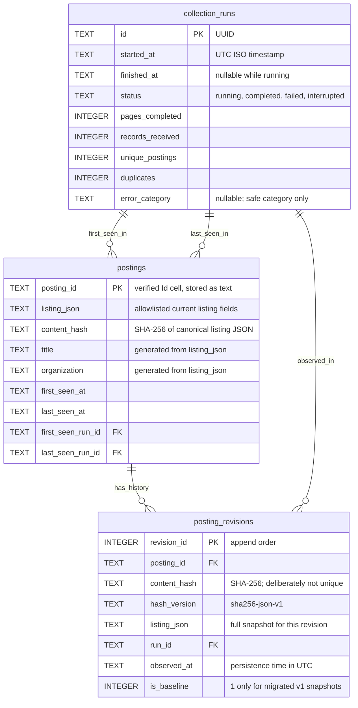

# WaterlooWorks Flash Next

WaterlooWorks Flash Next is a private, single-user WaterlooWorks listing browser with explicit manual refresh, search, filters, and SQLite history. Individual posting pages, detail collection, and analysis are deferred.

## The idea

Instead of opening every posting to compare job details, students can browse a clearer, more searchable view of WaterlooWorks listings.

The wrapper aims to extract and organize information such as:

- **Salary:** Compensation amounts, ranges, and pay periods when available.
- **Keywords:** Technologies, skills, responsibilities, and other relevant terms.
- **Location:** Where a role is based.
- **Work arrangement:** Remote, hybrid, or in-person status.

Missing or ambiguous details should be clearly marked rather than presented as confirmed facts.

## Planned workflow

1. Fetch the latest postings from WaterlooWorks through an authorized access method.
2. Analyze each posting and normalize its key fields.
3. Present the results in an easy-to-scan interface with search and filtering.
4. Link back to the original posting for full details and applications.

## Backend stack

- **Python + uv:** Backend development, dependency management, and environment setup.
- **Pydantic:** Typed data models and validation for job postings and extracted fields.
- **Playwright:** Browser automation for complex scraping flows.
- **Direct HTTP requests:** Fast data retrieval where browser automation is unnecessary.

Prefer direct requests when practical, using Playwright for browser interaction and authentication. The listing collector currently uses Python's standard-library HTTP client; per-posting retrieval remains to be implemented.

## Data schematic (observed so far)

This describes the fields observed during guided exploration and the current core/export mapping—not a finalized API contract. No mock postings or sample values are included.

```text
Paged listing response
├── totalResults: integer
├── page: integer
└── data: row[]
    ├── id: platform row identifier (not used by the collector)
    └── data: cell[]
        ├── key: field name
        └── value: JSON value (type depends on the field)

Collected listings
└── keyed by posting ID from the "Id" cell
    └── listing row, retained in memory

Private JSON export
├── exported_at: UTC timestamp string
├── complete: boolean
├── pages_completed: integer
├── records_received: integer
├── unique_postings: integer
├── duplicates: integer
└── postings: exported listing[]
```

### Listing fields and export mapping

| Observed source field   | Export field        | Meaning / current handling                                     |
| ----------------------- | ------------------- | -------------------------------------------------------------- |
| `Id`                    | `id`                | Posting ID; normalized to a string and used for deduplication  |
| `JobTitle.postingTitle` | `title`             | Title extracted from the `JobTitle` cell's object value        |
| `Organization`          | `organization`      | Organization name                                              |
| `Division`              | `division`          | Organization division                                          |
| `Openings`              | `openings`          | Number of openings as supplied                                 |
| `City`                  | `city`              | Listed city/location text                                      |
| `Level`                 | `level`             | Posting's level field                                          |
| `ApplicationCount`      | `application_count` | Application count as supplied                                  |
| `Deadline`              | `deadline`          | Display deadline as supplied; not yet normalized to a datetime |

Apart from ID and title handling, exported values retain their source JSON types; numeric/date normalization is not applied to storage or export. The frontend separately derives validated numeric ordering and deadline countdowns. Fields absent from a row are omitted, not invented.

Other observed cells: `postingId`, lowercase `deadline`, `canApply`, `hasApplication`, `online`, and `apply`. The `JobTitle` object also contains `new`, `featured`, `applied`, and `viewed` flags. These are **not exported**. `postingId` is distinct from the row-level `id` and the `Id` cell; their equivalence has not been established.

### Per-posting detail response (exploratory only)

Clicking a title produced two POSTs with `action` and `postingId`: one returned JSON metadata, the other markup. The metadata contained:

- Strings: `div`, `internalStatus`, `org`, `position`, `status`.
- Integers: `id`, `divId`.
- Boolean: `hasPreScreening`.
- Objects: `applicationData`, `geoData`.
- Arrays: `defaultLocations`, `tags`.

Nested schemas and markup extraction remain **placeholders**; no detail collector is implemented. Salary, keywords, and remote/hybrid/in-person analysis also remain **placeholders** until their sources and extraction rules are verified.

## SQLite storage model

Schema v3 uses Python's built-in `sqlite3` and Pydantic's `StoredListing` model in `backend/src/waterlooworks_flash_next/database.py`. The private local database is **`data/waterlooworks.sqlite3`**; the entire `data/` directory, including WAL files, is excluded from Git, formatting, and Docker build contexts.



- **`collection_runs`:** Collection-level provenance and counters. Completed/failed/interrupted runs require a finish timestamp. Counts must be nonnegative, and records must equal unique postings plus duplicates. Never store exception text, credentials, cookies, or request templates.
- **`postings`:** One latest listing snapshot per posting ID. `listing_json` uses the export field names above and rejects extra root keys. It preserves unnormalized JSON types for fields such as openings, level, and deadline; missing fields are distinct from explicit nulls. Title and organization are generated, indexed columns for search.
- **`posting_revisions`:** Append-only full snapshots, with a hash, run reference, and observation timestamp. SQL triggers reject updates/deletes. Order a posting's history by `revision_id`; compare adjacent `listing_json` values to see changed fields.
- **Change detection:** `sha256-json-v1` hashes compact UTF-8 JSON with recursively sorted object keys. Object key order and formatting do not create changes; array order, field values/types, and missing versus explicit null do. Run IDs and observation timestamps are excluded; all allowlisted listing fields—including application count—are included. NaN/Infinity are rejected. This is change detection, not encryption or tamper-proof auditing.
- **Repeat observations:** First observation creates a revision. An identical current hash updates only the latest snapshot's last-seen metadata. A changed hash appends a revision and updates the current snapshot atomically. Reverting to an earlier hash creates another revision, so history does not collapse reversions.
- **Relationships:** First/last-seen runs and revision run references are protected by foreign keys. No deletion/inactive state is inferred from absence. Unchanged observations are not separate revisions; every run-to-posting membership is not retained.
- **SQLite settings:** Transactional upgrades through v3 (`user_version=3`), STRICT tables, JSON checks, foreign keys, WAL mode, and a five-second busy timeout. Existing v1 snapshots become marked baseline revisions at their last-known observation; earlier changes cannot be reconstructed. Requires SQLite 3.37+ with JSON support. Newer schemas are rejected rather than downgraded.
- **Core API:** `open_database(path)` initializes/migrates the database; the caller closes it. `start_collection_run(connection)` creates empty run metadata only. `save_listings(connection, run_id, listings)` takes validated `StoredListing` objects, saves a batch in one transaction, and returns the number of new revisions. It requires a running run, rejects duplicate IDs within a batch, and does not commit a caller's pre-existing transaction. Run counters/finalization remain the caller's responsibility.

**Scope:** Listing refresh is wired through a local FastAPI API to SQLite and listing history. Detail storage models exist, but per-posting detail collection, content extraction, and analysis remain placeholders. Tests cover schema/migration behavior and API safety without invented postings. A single authorized live API run persisted 1,216 postings; populated historical migrations and detail lifecycles remain unverified. No private postings or mock data are seeded. Use local disk, restrict filesystem access, and back up SQLite consistently (including WAL state); this database is not encrypted. Future Docker access requires a runtime volume, never image contents.

### Detail model and independent history

The database also contains **`posting_details`**, **`posting_detail_revisions`**, and **`posting_fetch_attempts`**, linked by the same posting ID. Details use separate hashes from listings. Changed content and reversions append revisions; unchanged successes reference the current revision. Failed fetches never replace valid data.

Strict detail metadata models cover title, organization/division, division ID, status/internal status, and pre-screening flag. Description, compensation text, work term, and other unverified content fields are explicitly **null-only placeholders**, not claimed extracted values.

See **[the complete posting model](docs/posting-model.md)** for the six-table relationship diagram, field types, hashing rules, attempt lifecycle, and storage APIs. SQLite v3 is ready locally. The listings-only refresh pipeline is wired; individual detail collection and content extraction are deferred.

## Frontend stack

- **React + Vite:** Frontend UI and development/build tooling.
- **HeroUI v3:** UI component library.
- **Framer Motion:** Animations and transitions.
- **React Icons:** Lucide icons for fields and controls; no custom HeroUI style overrides.

## Local application

- **Posting cards:** stronger title, building icon + company, hash icon + posting ID beside a quiet deadline label (colored Chips when urgent), a divider, then stacked location/application/opening rows; 18 cards per page. Building/pin/hash icons replace redundant visible field labels but retain accessible names. People/calendar icons accompany correctly pluralized counts.
- **Search:** title-only, case-insensitive, applied after 125 ms of idle typing. Clearing applies immediately.
- **Filters:** a slightly wider HeroUI card with outer shadow clearance contains Organization, Country, and City (the stored location), with a Clear button that resets filters without clearing title search. Unselected controls and labels are neutral/muted; selected controls receive subtle emphasis through documented HeroUI props. Smaller centered HeroUI modals show searchable checkbox lists grouped under A–Z and Others headings with option counts, one indented option per row. Compact 40px rows use viewport-sized buffered virtualization without pagination. Scroll measurements are coalesced per animation frame, existing HeroUI rows are memoized, and scrolling state is isolated from the workspace. HeroUI ScrollShadow handles scrolling. Search keeps modal dimensions stable and retains selections. Closing preserves the modal content until its exit animation finishes. Apply commits, Cancel discards, and Clear selection resets the draft. Selections are OR within each filter and AND across filters. Options come only from stored data; country stays disabled while unverified.
- **Manual refresh:** neutral while idle, subtly emphasized while active; an explicit action with sanitized SSE logs and page progress. One run at a time, a 5-minute cooldown, and existing 2-second sequential fetch pacing. Cooldown/running clicks show top-centered explanatory toasts without another POST; there is no cooldown countdown. Server 409/429 race responses are handled the same way. Offline, disabled-server, and request-in-flight guards remain. Loading/reconnecting never starts scraping.
- **Progress:** stage, page/record/duplicate counts, and an approximate client ETA seeded from the collector estimate. The display drops one second every 1,200 ms between samples and resets to each completed page's latest collector estimate, including upward revisions. When a sample expires, it shows “Updating ETA…” rather than remaining at one second or implying completion. Unestimated stages and retries show unavailable; a new run resets the countdown. The API's `eta_seconds` remains the unchanged collector estimate. Log messages appear only in the console, not repeated below the progress bar.
- **Focused layout:** follows HeroUI's semantic hierarchy and progressive disclosure: compact header, desktop filter sidebar, search-first mobile order, and title-focused cards. No summary tiles or individual posting pages/modals. Listing history is retained in SQLite, not shown as an individual view. HeroUI skeleton cards mirror the header, title, company, ID/deadline row, divider, and three icon/detail rows before crossfading into loaded cards; reduced motion disables animation. The results fill remaining viewport space and scroll through HeroUI ScrollShadow with the scrollbar hidden. Page changes scroll smoothly to the top unless reduced motion is requested. Total count, current/total pages, and the number shown on the current page share one status line; only filtered listings are called results.
- **Sort by:** default (posting ID ascending), recently added, time remaining, most applications, most openings, and organization. Applied before pagination; changing sort returns to page 1. Recently added uses local `first_seen_at`, not source publication dates. Unknown counts sort last; ties use posting ID. Time remaining puts upcoming deadlines nearest-first, then passed deadlines most-recent-first, then unknowns.
- **Deadlines:** the verified abbreviated-month/12-hour display format is interpreted in `America/Toronto` using `@internationalized/date`. Waterloo's [official recruiting schedule](https://uwaterloo.ca/co-operative-education/important-dates) explicitly labels “Job postings close (ET)”. Day/hour countdowns update every minute and on tab return; the original value remains unchanged and is available on hover. Invalid dates, unsupported formats, and ambiguous/nonexistent DST times stay unknown. “Deadline passed” does not claim the source posting is closed. Over three days uses muted regular text; one–three days uses soft amber; under 24 hours uses soft red, and under one hour uses the strongest red variant.
- **Hierarchy and contrast:** documented HeroUI typography and semantic color props make titles larger/stronger and metadata quieter—no opacity or component CSS overrides. Following [W3C text contrast guidance](https://www.w3.org/WAI/WCAG21/Understanding/contrast-minimum.html) and [NN/g hierarchy guidance](https://www.nngroup.com/articles/visual-hierarchy-ux-definition/), rendered card text was measured in both themes: minimum 4.83:1 light and 6.75:1 dark (above the 4.5:1 ordinary-text threshold). This is not a full accessibility audit.
- **Approved custom pagination wrapper:** `frontend/src/app/App.tsx` and `frontend/src/styles/index.css` contain the explicitly user-approved floating outer panel because HeroUI's Card has no padding/blur props. Its intrinsic width follows the page links; background uses 55% surface color and 24px backdrop blur. The HeroUI pagination controls themselves remain unmodified. This exception does not authorize other component CSS overrides.
- **Console:** appears for an observed active refresh as a clickable three-line preview, without a separately styled button. HeroUI's unstyled disclosure trigger retains keyboard/focus semantics; expanding shows timestamped monospace logs up to the existing viewport-relative height cap. Three seconds after completion, failure, or interruption it fades and collapses smoothly, moving the content below without a final gap jump; reduced motion is immediate. Old terminal runs do not flash on page load. Displays the latest 200 reviewed entries with muted timestamps/debug text, blue INFO, amber WARNING, and red ERROR/CRITICAL severity labels using unmodified HeroUI components. Critical entries use a stronger filled badge. Messages remain escaped plain text; secrets and private diagnostics remain excluded. Expanded logs follow new entries only when already at the bottom. Scrolling up pauses following; “Jump to latest” resumes it.
- **Shareable view:** `q`, `page`, `sort`, and repeated `organization`, `country`, and `city` URL parameters restore title search, pagination, sorting, and multi-select filters across reloads and Back/Forward. Defaults are omitted. Invalid pages/sorts are normalized; pages are clamped only after stored data loads. Unmatched filter values remain explicit and produce no matches rather than silently broadening the search. Links describe the view, not the data: recipients need access to the application and its authorized dataset. Transient dialogs/log state and credentials are not included.
- **Theme:** HeroUI System/Light/Dark tabs with monitor/sun/moon icons. System follows OS changes; only the theme preference is saved in browser local storage, separate from shared URLs.
- **Brand mark:** the user-requested original SVG in `frontend/public/brand.svg` uses two concentric circular rings, each split into three blue arcs, with the inner ring rotated 60 degrees so their gaps alternate, inspired by the supplied WaterlooWorks favicon rather than the university crest. It appears to the left of the title; it is not an official WaterlooWorks logo. The user-requested custom `frontend/src/app/BrandMark.tsx` animation reuses that SVG geometry: during login/refresh the outer ring turns clockwise every 4.8 seconds while the inner turns counterclockwise every 3.2 seconds. It settles back to the original mark when work ends and stays static with reduced motion. Only the custom brand asset is animated; HeroUI controls remain unmodified.
- **API docs:** Swagger UI at `/doc`; machine OpenAPI at `/doc/openapi.json`. Generated frontend types and CI drift checks keep the contract synchronized.

See [local API setup and safeguards](docs/local-api.md). Start the API on loopback port 8787, then `npm run dev -- --host 127.0.0.1` for the frontend on port 5173 (or use `npm run dev --workspace frontend -- --host 127.0.0.1`). Vite proxies `/api` and `/doc`; no cross-origin browser credentials are needed. **Containers have not been started; backend container integration remains pending.**

## Proposed project structure

A single repository with separate backend and frontend applications, a local listings API, tests, and quality tooling. The tree below also includes planned modules; unimplemented directories and files will be added only when needed.

```text
waterlooworks-flash-next/
├── README.md
├── CONTRIBUTING.md
├── package.json             # npm workspace and shared quality commands
├── package-lock.json
├── .github/workflows/ci.yml # Frontend and backend quality gates
├── .gitignore
├── .dockerignore             # Exclude experiments, secrets, and local data
├── .prettierignore
├── .prettierrc.json          # Shared Prettier configuration
├── compose.yaml             # dev/prod profiles
├── docs/
│   └── scraping-workflow.md # Verified Playwright navigation flowchart
├── backend/
│   ├── pyproject.toml       # Python dependencies, Ruff, and tool settings
│   ├── uv.lock
│   ├── Dockerfile          # Placeholder until backend entry point is defined
│   ├── src/
│   │   └── waterlooworks_flash_next/
│   │       ├── __init__.py
│   │       ├── login.py     # Browser startup and credential entry
│   │       ├── duo.py       # Duo branches and authenticated arrival
│   │       ├── jobs.py      # Board navigation and passive request capture
│   │       ├── listings.py  # Paced direct listing fetches and models
│   │       ├── export.py    # Private, allowlisted JSON exports
│   │       ├── database.py  # SQLite initialization and listing persistence
│   │       ├── details.py   # Verified metadata and reserved content models
│   │       ├── detail_schema.py # Detail-history schema migration
│   │       ├── detail_storage.py # Atomic detail attempt/history APIs
│   │       ├── logging.py   # Safe colored stage logs
│   │       ├── config.py    # Planned runtime configuration
│   │       ├── models/     # Pydantic data models
│   │       ├── scraping/   # Verified Playwright and direct HTTP flows
│   │       ├── analysis/   # Field extraction and normalization
│   │       └── services/   # Retrieval and analysis orchestration
│   └── tests/
│       ├── unit/
│       └── integration/    # Live access explicitly opt-in
├── frontend/
│   ├── package.json
│   ├── Dockerfile
│   ├── index.html
│   ├── vite.config.ts
│   ├── tsconfig.json
│   ├── eslint.config.js
│   ├── public/
│   ├── src/
│   │   ├── main.tsx
│   │   ├── app/            # App composition and providers
│   │   ├── components/     # Reusable UI built with HeroUI v3
│   │   ├── features/       # Feature-specific UI and logic
│   │   ├── lib/            # Shared utilities and backend integration
│   │   └── styles/
│   └── tests/
│       ├── unit/
│       └── integration/
├── tests/
│   └── e2e/                # Application-level end-to-end checks
└── .experiment/            # Always gitignored; never shipped
    └── test/               # Guided interactive Python exploration
```

- Keep scraping, analysis, and UI concerns separate. Promote verified experimental work into the backend rather than depending on `.experiment/` at runtime.
- Tooling: npm workspaces with a root `package-lock.json`, pytest for Python, Vitest and Testing Library for React, mypy for Python type checks, and GitHub Actions for CI. Explicit local browser verification uses Playwright; no live platform access runs in CI.
- Backend API: FastAPI + Uvicorn, with OpenAPI-generated frontend types. Listings are wired to SQLite v3; detail fetching and automated scheduling remain deferred.
- Private database files live under ignored `data/`; browser state remains under ignored `.experiment/`. Docker runtime volume configuration: **Placeholder — to be defined.**
- Test directories do not imply mock datasets or fixtures; follow the placeholder policy below.

## Deployment model

The project will be public, but each running instance is intended for **one person only**, not as a shared multi-user service. Credentials, personal data, and fetched postings should remain private to that instance and out of the public repository.

The deployment goal is to start the service with a single Docker Compose command after initial configuration, with two profiles:

- **`dev`:** Local development.
- **`prod`:** Normal self-hosted use.

The initial Compose configuration builds **only the frontend**, without a backend service. Local API integration is tested outside Docker; container API/proxy wiring remains pending:

```sh
# Development: http://localhost:5173
docker compose --profile dev up --build

# Production: http://localhost:8080
docker compose --profile prod up -d --build
```

Both profiles bind to localhost. Development mounts frontend source for hot reload; rebuild after dependency or configuration changes. Containerized backend services, private storage mounts, and automated scheduling remain placeholders; authenticated exploration currently runs locally. Container execution requires a running Docker daemon.

## Backend core

Reusable modules under `backend/src/waterlooworks_flash_next/` provide authentication, Duo handling, job-board navigation, paced listing collection, logging, and private JSON export. Temporary launchers and execution scripts have been removed; no collection starts automatically. The local API now composes them only after an accepted explicit refresh request.

Collection must immediately follow fresh authentication and runtime request capture. During API refresh, the browser closes after capturing page 1 and copying the request/session information into memory, before direct HTTP collection starts. No logout request is made; failure cleanup remains in place. This early-close handoff has an offline structural regression but has not yet been exercised in a live refresh. Listings are fetched sequentially in batches of up to three pages, with a 2-second completion-to-next-start interval and at most two transient-error retries at 4 and 8 seconds. Progress logs report counts and ETA. No per-posting detail fetching is implemented.

`export_listings()` writes only completed results to a caller-supplied private directory, normally ignored `.experiment/output/`. Its allowlist excludes credentials, cookies, action tokens, and internal apply controls. See [the workflow and core API notes](docs/scraping-workflow.md).

## Local setup and checks

Requirements: Node.js 22.22.3 or newer compatible LTS, npm, and uv. The backend pins Python 3.12, which uv can provision. Use Docker with Compose for container startup.

```sh
# From the repository root
npm ci
npm run dev
```

```sh
# In a separate terminal, from the repository root
cd backend
uv sync --locked
```

Quality checks:

```sh
# From the repository root: formatting, linting, types, tests, build
npm run check

# Backend checks
cd backend
uv run ruff format --check .
uv run ruff check .
uv run mypy
uv run pytest
uv build
```

Use `npm run format` and, within `backend/`, `uv run ruff format .` to apply formatting. Playwright browser binaries are not needed for these checks; install Chromium with `uv run playwright install chromium` from `backend/` when guided browser exploration begins. No login or data fetching is performed during setup.

See [CONTRIBUTING.md](CONTRIBUTING.md) for the contribution and privacy rules.

## Project-scoped HeroUI MCP

[HeroUI’s official React MCP server](https://www.heroui.com/docs/react/getting-started/mcp-server) supplies v3 component documentation to coding agents. It is development tooling, not part of the application or Docker services.

- `.mcp.json` configures the official `@heroui/react-mcp` server, pinned to `1.1.2`.
- Pi requires an MCP adapter supplied by the user's Pi setup. This repository does not install or auto-install Pi plugins.
- `.pi/mcp.json` sets `heroui-react` to `keep-alive` with direct tools: connect at startup, avoid idle shutdown, and expose its tools to the agent.
- `AGENTS.md` instructs agents to consult the official v3 documentation before HeroUI changes and report connection failures.

Start Pi **from the repository root**, trust the project when prompted, and restart after setup. Node.js 22+ and network access are required for the MCP server and its documentation. With an adapter available, run `/mcp` to verify `heroui-react` is connected; use `/mcp reconnect heroui-react` if needed. A missing adapter, project trust, explicit extension disabling, or network failures can prevent loading—configuration cannot guarantee service availability.

**Agents must ask the user to install any needed Pi plugin themselves.** Do not install plugins globally or locally, or add project settings that auto-install them.

The HeroUI server configuration remains project-scoped; no global MCP settings are needed or changed. Local Pi packages, caches, traces, and session artifacts are ignored. Other MCP clients may read `.mcp.json`, but their startup and trust behavior is client-specific; `.pi/mcp.json` applies only to Pi.

## Local credentials

Put your WaterlooWorks credentials in the root `.credentials.json`, using the `username` and `password` keys. Manage its values yourself; agents do not inspect or overwrite it. It is ignored by Git and Prettier and excluded from Docker build contexts.

Agents must not view or inspect this file. Authentication code loads it dynamically only when needed, without printing credentials or including them in logs, errors, or artifacts. Never commit the file or bake it into an image; future container access requires an explicit runtime secret or read-only mount. This is plaintext storage, so restrict local filesystem access; Git ignore rules are not encryption.

## Agent workspace

The `.experiment/` folder is a local scratch workspace where agents can run quick tests and clone or inspect other repositories. It must always remain in `.gitignore`; its contents must not be committed.

## Guided scraping development

Development will begin with an agent running an interactive uv-managed Python shell in `.experiment/test/`. You will provide screenshots and text to guide the agent through WaterlooWorks, from login to fetching information, and specify what to record along the way.

The agent will turn the verified steps into a reproducible script. A flowchart in [docs/scraping-workflow.md](docs/scraping-workflow.md) will map how Playwright moves through WaterlooWorks itself: verified pages, browser actions, navigation transitions, and information retrieval points. It describes the automation’s path through the platform, not our development process, and will be filled in as we explore.

## Engineering standards

- **Conventional Commits:** Use the Conventional Commits format for commit messages, with appropriate types, optional scopes, and breaking-change markers.
- **Test-driven development (TDD):** Write a failing test for the intended behavior, implement the minimum needed to pass, then refactor. Cover fixes with regression tests.
- **Formatting and linting:** Use Prettier for frontend code and supported documentation/configuration formats, ESLint for frontend linting, and Ruff for Python formatting and linting.
- **Type safety:** Use TypeScript with strict checks for the React frontend and type annotations with a static type checker for Python. Pydantic provides runtime validation, not a replacement for static checks. Use mypy in strict mode for Python.
- **Quality gates:** Require formatting, linting, type checks, tests, and applicable build checks to pass in CI before merging. GitHub Actions runs these checks; the repository owner must enable branch protection to make them required before merging.
- **Testing boundaries:** Keep routine tests deterministic and independent of live WaterlooWorks access. Authenticated integration checks must be explicitly opted into and keep credentials and private data out of logs and artifacts. Follow the placeholder policy: do not add mock data or invented platform behavior.
- **Maintainability and security:** Keep changes focused, handle errors explicitly, validate external inputs, commit dependency lockfiles, and never commit secrets or private data.
- **Accessibility:** Use semantic markup, keyboard-accessible interactions, and reduced-motion support in the frontend.

Formatting, linting, type checks, baseline tests, and CI configuration are implemented. Conventional Commits are currently review-enforced; platform-specific tests and E2E checks await verified behavior.

## Placeholder policy

Use placeholders for anything not yet provided, verified, or implemented. Do not introduce mock data, sample postings, fabricated API responses, or speculative platform flows. This applies across documentation, scraping, data models, backend, frontend, and deployment configuration. Keep confirmed technology choices and requirements; fill in unknown details only as they are established.

## Status

HeroUI posting browser plus a local listings API and SQLite history. A single live API E2E verified fresh authentication, **25 pages / 1,216 unique postings**, persisted revisions, SSE progress, duplicate-refresh rejection (409), and cooldown rejection (429). The dedicated browser profile stays private under `.experiment/browser-profile/`.

Read-only browser checks against the current 1,218 stored listings verified the stacked card fields, deadline parsing, all six sorts, debounced title search, city/organization grouped multi-select checkbox lists, disabled unknown country, persistent pagination, inner scrolling, mobile overflow containment, theme persistence, and console scroll pause/resume. Deadline checks also ran with the browser timezone set to Asia/Tokyo. No individual posting views are present. Browser checks made zero refresh POSTs and zero WaterlooWorks requests, with no page errors.

Credential-free tests cover pacing, retry policy, encoding, destination checks, logging, API contracts/guards, empty UI states, theme persistence, and console follow behavior. No mock postings are shipped. Live transient-retry behavior, populated historical migrations, and full-data JSON export remain unverified. Individual detail fetching is intentionally not part of manual refresh.

Access should respect WaterlooWorks policies and protect students’ credentials and personal data. This is an independent project, not an official WaterlooWorks product.
