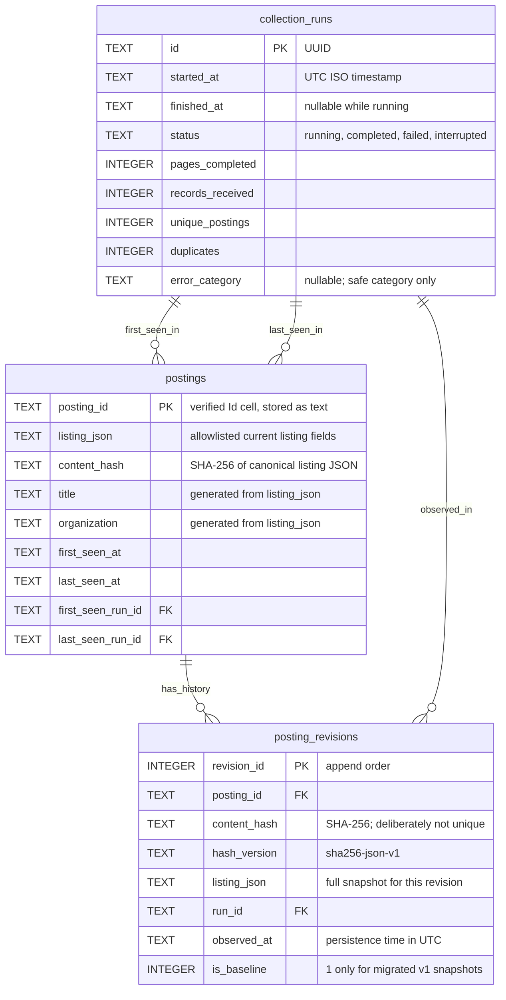

# WaterlooWorks Flash Next

WaterlooWorks Flash Next is a planned WaterlooWorks wrapper that automatically fetches the latest job postings and analyzes their key details, helping students find relevant opportunities faster.

## The idea

Instead of opening every posting to compare job details, students can browse a clearer, more searchable view of WaterlooWorks listings.

The wrapper aims to extract and organize information such as:

- **Salary:** Compensation amounts, ranges, and pay periods when available.
- **Keywords:** Technologies, skills, responsibilities, and other relevant terms.
- **Location:** Where a role is based.
- **Work arrangement:** Remote, hybrid, or in-person status.

Missing or ambiguous details should be clearly marked rather than presented as confirmed facts.

## Planned workflow

1. Fetch the latest postings from WaterlooWorks through an authorized access method.
2. Analyze each posting and normalize its key fields.
3. Present the results in an easy-to-scan interface with search and filtering.
4. Link back to the original posting for full details and applications.

## Backend stack

- **Python + uv:** Backend development, dependency management, and environment setup.
- **Pydantic:** Typed data models and validation for job postings and extracted fields.
- **Playwright:** Browser automation for complex scraping flows.
- **Direct HTTP requests:** Fast data retrieval where browser automation is unnecessary.

Prefer direct requests when practical, using Playwright for browser interaction and authentication. The listing collector currently uses Python's standard-library HTTP client; per-posting retrieval remains to be implemented.

## Data schematic (observed so far)

This describes the fields observed during guided exploration and the current core/export mapping—not a finalized API contract. No mock postings or sample values are included.

```text
Paged listing response
├── totalResults: integer
├── page: integer
└── data: row[]
    ├── id: platform row identifier (not used by the collector)
    └── data: cell[]
        ├── key: field name
        └── value: JSON value (type depends on the field)

Collected listings
└── keyed by posting ID from the "Id" cell
    └── listing row, retained in memory

Private JSON export
├── exported_at: UTC timestamp string
├── complete: boolean
├── pages_completed: integer
├── records_received: integer
├── unique_postings: integer
├── duplicates: integer
└── postings: exported listing[]
```

### Listing fields and export mapping

| Observed source field   | Export field        | Meaning / current handling                                     |
| ----------------------- | ------------------- | -------------------------------------------------------------- |
| `Id`                    | `id`                | Posting ID; normalized to a string and used for deduplication  |
| `JobTitle.postingTitle` | `title`             | Title extracted from the `JobTitle` cell's object value        |
| `Organization`          | `organization`      | Organization name                                              |
| `Division`              | `division`          | Organization division                                          |
| `Openings`              | `openings`          | Number of openings as supplied                                 |
| `City`                  | `city`              | Listed city/location text                                      |
| `Level`                 | `level`             | Posting's level field                                          |
| `ApplicationCount`      | `application_count` | Application count as supplied                                  |
| `Deadline`              | `deadline`          | Display deadline as supplied; not yet normalized to a datetime |

Apart from ID and title handling, exported values retain their source JSON types; numeric/date normalization is not implemented. Fields absent from a row are omitted, not invented.

Other observed cells: `postingId`, lowercase `deadline`, `canApply`, `hasApplication`, `online`, and `apply`. The `JobTitle` object also contains `new`, `featured`, `applied`, and `viewed` flags. These are **not exported**. `postingId` is distinct from the row-level `id` and the `Id` cell; their equivalence has not been established.

### Per-posting detail response (exploratory only)

Clicking a title produced two POSTs with `action` and `postingId`: one returned JSON metadata, the other markup. The metadata contained:

- Strings: `div`, `internalStatus`, `org`, `position`, `status`.
- Integers: `id`, `divId`.
- Boolean: `hasPreScreening`.
- Objects: `applicationData`, `geoData`.
- Arrays: `defaultLocations`, `tags`.

Nested schemas and markup extraction remain **placeholders**; no detail collector is implemented. Salary, keywords, and remote/hybrid/in-person analysis also remain **placeholders** until their sources and extraction rules are verified.

## SQLite storage model

Schema v2 uses Python's built-in `sqlite3` and Pydantic's `StoredListing` model in `backend/src/waterlooworks_flash_next/database.py`. The private local database is **`data/waterlooworks.sqlite3`**; the entire `data/` directory, including WAL files, is excluded from Git, formatting, and Docker build contexts.



- **`collection_runs`:** Collection-level provenance and counters. Completed/failed/interrupted runs require a finish timestamp. Counts must be nonnegative, and records must equal unique postings plus duplicates. Never store exception text, credentials, cookies, or request templates.
- **`postings`:** One latest listing snapshot per posting ID. `listing_json` uses the export field names above and rejects extra root keys. It preserves unnormalized JSON types for fields such as openings, level, and deadline; missing fields are distinct from explicit nulls. Title and organization are generated, indexed columns for search.
- **`posting_revisions`:** Append-only full snapshots, with a hash, run reference, and observation timestamp. SQL triggers reject updates/deletes. Order a posting's history by `revision_id`; compare adjacent `listing_json` values to see changed fields.
- **Change detection:** `sha256-json-v1` hashes compact UTF-8 JSON with recursively sorted object keys. Object key order and formatting do not create changes; array order, field values/types, and missing versus explicit null do. Run IDs and observation timestamps are excluded; all allowlisted listing fields—including application count—are included. NaN/Infinity are rejected. This is change detection, not encryption or tamper-proof auditing.
- **Repeat observations:** First observation creates a revision. An identical current hash updates only the latest snapshot's last-seen metadata. A changed hash appends a revision and updates the current snapshot atomically. Reverting to an earlier hash creates another revision, so history does not collapse reversions.
- **Relationships:** First/last-seen runs and revision run references are protected by foreign keys. No deletion/inactive state is inferred from absence. Unchanged observations are not separate revisions; every run-to-posting membership is not retained.
- **SQLite settings:** Transactional v1-to-v2 migration (`user_version=2`), STRICT tables, JSON checks, foreign keys, WAL mode, and a five-second busy timeout. Existing v1 snapshots become marked baseline revisions at their last-known observation; earlier changes cannot be reconstructed. Requires SQLite 3.37+ with JSON support. Newer schemas are rejected rather than downgraded.
- **Core API:** `open_database(path)` initializes/migrates the database; the caller closes it. `start_collection_run(connection)` creates empty run metadata only. `save_listings(connection, run_id, listings)` takes validated `StoredListing` objects, saves a batch in one transaction, and returns the number of new revisions. It requires a running run, rejects duplicate IDs within a batch, and does not commit a caller's pre-existing transaction. Run counters/finalization remain the caller's responsibility.

**Scope:** Schema, hashing, revision persistence, and posting upserts are implemented. Automatic collector-to-database wiring, run finalization, and details/analysis tables remain placeholders. Tests cover generic JSON/hash behavior, empty-schema migration/rollback, and transaction boundaries; populated history and backfill have not been verified with real postings. No private postings or mock data are seeded. Use local disk, restrict filesystem access, and back up SQLite consistently (including WAL state); this database is not encrypted. Future Docker access requires a runtime volume, never image contents.

## Frontend stack

- **React + Vite:** Frontend UI and development/build tooling.
- **HeroUI v3:** UI component library.
- **Framer Motion:** Animations and transitions.

## Proposed project structure

A single repository with separate backend and frontend applications. The initial scaffold implements the placeholder frontend, Python package, tests, and quality tooling. The tree below also includes planned modules; unimplemented directories and files will be added only when needed.

```text
waterlooworks-flash-next/
├── README.md
├── CONTRIBUTING.md
├── package.json             # npm workspace and shared quality commands
├── package-lock.json
├── .github/workflows/ci.yml # Frontend and backend quality gates
├── .gitignore
├── .dockerignore             # Exclude experiments, secrets, and local data
├── .prettierignore
├── .prettierrc.json          # Shared Prettier configuration
├── compose.yaml             # dev/prod profiles
├── docs/
│   └── scraping-workflow.md # Verified Playwright navigation flowchart
├── backend/
│   ├── pyproject.toml       # Python dependencies, Ruff, and tool settings
│   ├── uv.lock
│   ├── Dockerfile          # Placeholder until backend entry point is defined
│   ├── src/
│   │   └── waterlooworks_flash_next/
│   │       ├── __init__.py
│   │       ├── login.py     # Browser startup and credential entry
│   │       ├── duo.py       # Duo branches and authenticated arrival
│   │       ├── jobs.py      # Board navigation and passive request capture
│   │       ├── listings.py  # Paced direct listing fetches and models
│   │       ├── export.py    # Private, allowlisted JSON exports
│   │       ├── database.py  # SQLite schema, initialization, and listing model
│   │       ├── logging.py   # Safe colored stage logs
│   │       ├── config.py    # Planned runtime configuration
│   │       ├── models/     # Pydantic data models
│   │       ├── scraping/   # Verified Playwright and direct HTTP flows
│   │       ├── analysis/   # Field extraction and normalization
│   │       └── services/   # Retrieval and analysis orchestration
│   └── tests/
│       ├── unit/
│       └── integration/    # Live access explicitly opt-in
├── frontend/
│   ├── package.json
│   ├── Dockerfile
│   ├── index.html
│   ├── vite.config.ts
│   ├── tsconfig.json
│   ├── eslint.config.js
│   ├── public/
│   ├── src/
│   │   ├── main.tsx
│   │   ├── app/            # App composition and providers
│   │   ├── components/     # Reusable UI built with HeroUI v3
│   │   ├── features/       # Feature-specific UI and logic
│   │   ├── lib/            # Shared utilities and backend integration
│   │   └── styles/
│   └── tests/
│       ├── unit/
│       └── integration/
├── tests/
│   └── e2e/                # Application-level end-to-end checks
└── .experiment/            # Always gitignored; never shipped
    └── test/               # Guided interactive Python exploration
```

- Keep scraping, analysis, and UI concerns separate. Promote verified experimental work into the backend rather than depending on `.experiment/` at runtime.
- Tooling: npm workspaces with a root `package-lock.json`, pytest for Python, Vitest and Testing Library for React, mypy for Python type checks, and GitHub Actions for CI. E2E tooling remains undecided.
- Backend API framework, scheduling, and runtime entry points: **Placeholder — to be decided.** SQLite schema v2 includes hashed revision history; integration with the collector remains pending.
- Private database files live under ignored `data/`; browser state remains under ignored `.experiment/`. Docker runtime volume configuration: **Placeholder — to be defined.**
- Test directories do not imply mock datasets or fixtures; follow the placeholder policy below.

## Deployment model

The project will be public, but each running instance is intended for **one person only**, not as a shared multi-user service. Credentials, personal data, and fetched postings should remain private to that instance and out of the public repository.

The deployment goal is to start the service with a single Docker Compose command after initial configuration, with two profiles:

- **`dev`:** Local development.
- **`prod`:** Normal self-hosted use.

The initial Compose configuration runs **only the placeholder frontend**:

```sh
# Development: http://localhost:5173
docker compose --profile dev up --build

# Production: http://localhost:8080
docker compose --profile prod up -d --build
```

Both profiles bind to localhost. Development mounts frontend source for hot reload; rebuild after dependency or configuration changes. Containerized backend services, private storage mounts, and automated scheduling remain placeholders; authenticated exploration currently runs locally. Container execution requires a running Docker daemon.

## Backend core

Reusable modules under `backend/src/waterlooworks_flash_next/` provide authentication, Duo handling, job-board navigation, paced listing collection, logging, and private JSON export. Temporary launchers and execution scripts have been removed; no collection starts automatically. The next application layer will compose these modules.

Collection must immediately follow fresh authentication and runtime request capture. Listings are fetched sequentially in batches of up to three pages, with a 2-second completion-to-next-start interval and at most two transient-error retries at 4 and 8 seconds. Progress logs report counts and ETA. No per-posting detail fetching is implemented.

`export_listings()` writes only completed results to a caller-supplied private directory, normally ignored `.experiment/output/`. Its allowlist excludes credentials, cookies, action tokens, and internal apply controls. See [the workflow and core API notes](docs/scraping-workflow.md).

## Local setup and checks

Requirements: Node.js 22.22.3 or newer compatible LTS, npm, and uv. The backend pins Python 3.12, which uv can provision. Use Docker with Compose for container startup.

```sh
# From the repository root
npm ci
npm run dev
```

```sh
# In a separate terminal, from the repository root
cd backend
uv sync --locked
```

Quality checks:

```sh
# From the repository root: formatting, linting, types, tests, build
npm run check

# Backend checks
cd backend
uv run ruff format --check .
uv run ruff check .
uv run mypy
uv run pytest
uv build
```

Use `npm run format` and, within `backend/`, `uv run ruff format .` to apply formatting. Playwright browser binaries are not needed for these checks; install Chromium with `uv run playwright install chromium` from `backend/` when guided browser exploration begins. No login or data fetching is performed during setup.

See [CONTRIBUTING.md](CONTRIBUTING.md) for the contribution and privacy rules.

## Project-scoped HeroUI MCP

[HeroUI’s official React MCP server](https://www.heroui.com/docs/react/getting-started/mcp-server) supplies v3 component documentation to coding agents. It is development tooling, not part of the application or Docker services.

- `.mcp.json` configures the official `@heroui/react-mcp` server, pinned to `1.1.2`.
- Pi requires an MCP adapter supplied by the user's Pi setup. This repository does not install or auto-install Pi plugins.
- `.pi/mcp.json` sets `heroui-react` to `keep-alive` with direct tools: connect at startup, avoid idle shutdown, and expose its tools to the agent.
- `AGENTS.md` instructs agents to consult the official v3 documentation before HeroUI changes and report connection failures.

Start Pi **from the repository root**, trust the project when prompted, and restart after setup. Node.js 22+ and network access are required for the MCP server and its documentation. With an adapter available, run `/mcp` to verify `heroui-react` is connected; use `/mcp reconnect heroui-react` if needed. A missing adapter, project trust, explicit extension disabling, or network failures can prevent loading—configuration cannot guarantee service availability.

**Agents must ask the user to install any needed Pi plugin themselves.** Do not install plugins globally or locally, or add project settings that auto-install them.

The HeroUI server configuration remains project-scoped; no global MCP settings are needed or changed. Local Pi packages, caches, traces, and session artifacts are ignored. Other MCP clients may read `.mcp.json`, but their startup and trust behavior is client-specific; `.pi/mcp.json` applies only to Pi.

## Local credentials

Put your WaterlooWorks credentials in the root `.credentials.json`, using the `username` and `password` keys. The local placeholder contains empty values; fill it in yourself. It is ignored by Git and Prettier and excluded from Docker build contexts.

Agents must not view or inspect this file. Authentication code loads it dynamically only when needed, without printing credentials or including them in logs, errors, or artifacts. Never commit the file or bake it into an image; future container access requires an explicit runtime secret or read-only mount. This is plaintext storage, so restrict local filesystem access; Git ignore rules are not encryption.

## Agent workspace

The `.experiment/` folder is a local scratch workspace where agents can run quick tests and clone or inspect other repositories. It must always remain in `.gitignore`; its contents must not be committed.

## Guided scraping development

Development will begin with an agent running an interactive uv-managed Python shell in `.experiment/test/`. You will provide screenshots and text to guide the agent through WaterlooWorks, from login to fetching information, and specify what to record along the way.

The agent will turn the verified steps into a reproducible script. A flowchart in [docs/scraping-workflow.md](docs/scraping-workflow.md) will map how Playwright moves through WaterlooWorks itself: verified pages, browser actions, navigation transitions, and information retrieval points. It describes the automation’s path through the platform, not our development process, and will be filled in as we explore.

## Engineering standards

- **Conventional Commits:** Use the Conventional Commits format for commit messages, with appropriate types, optional scopes, and breaking-change markers.
- **Test-driven development (TDD):** Write a failing test for the intended behavior, implement the minimum needed to pass, then refactor. Cover fixes with regression tests.
- **Formatting and linting:** Use Prettier for frontend code and supported documentation/configuration formats, ESLint for frontend linting, and Ruff for Python formatting and linting.
- **Type safety:** Use TypeScript with strict checks for the React frontend and type annotations with a static type checker for Python. Pydantic provides runtime validation, not a replacement for static checks. Use mypy in strict mode for Python.
- **Quality gates:** Require formatting, linting, type checks, tests, and applicable build checks to pass in CI before merging. GitHub Actions runs these checks; the repository owner must enable branch protection to make them required before merging.
- **Testing boundaries:** Keep routine tests deterministic and independent of live WaterlooWorks access. Authenticated integration checks must be explicitly opted into and keep credentials and private data out of logs and artifacts. Follow the placeholder policy: do not add mock data or invented platform behavior.
- **Maintainability and security:** Keep changes focused, handle errors explicitly, validate external inputs, commit dependency lockfiles, and never commit secrets or private data.
- **Accessibility:** Use semantic markup, keyboard-accessible interactions, and reduced-motion support in the frontend.

Formatting, linting, type checks, baseline tests, and CI configuration are implemented. Conventional Commits are currently review-enforced; platform-specific tests and E2E checks await verified behavior.

## Placeholder policy

Use placeholders for anything not yet provided, verified, or implemented. Do not introduce mock data, sample postings, fabricated API responses, or speculative platform flows. This applies across documentation, scraping, data models, backend, frontend, and deployment configuration. Keep confirmed technology choices and requirements; fill in unknown details only as they are established.

## Status

Placeholder frontend plus a reusable backend core. Guided live runs verified authentication branches, direct board navigation, and a complete listing pass of **25 pages / 1,216 unique postings / zero duplicates** after correcting response-capture timing and ISO-8859-1 decoding. The dedicated browser profile stays private under `.experiment/browser-profile/`.

Launch scripts have been removed. Credential-free tests cover pacing, retry policy, encoding, destination checks, logging, and JSON writing. Live transient-retry behavior and full-data JSON export remain unverified. SQLite schema v2 and hashed revision persistence are implemented but not yet wired to collection. No per-posting detail collector, mock data, or application API is implemented.

Access should respect WaterlooWorks policies and protect students’ credentials and personal data. This is an independent project, not an official WaterlooWorks product.
