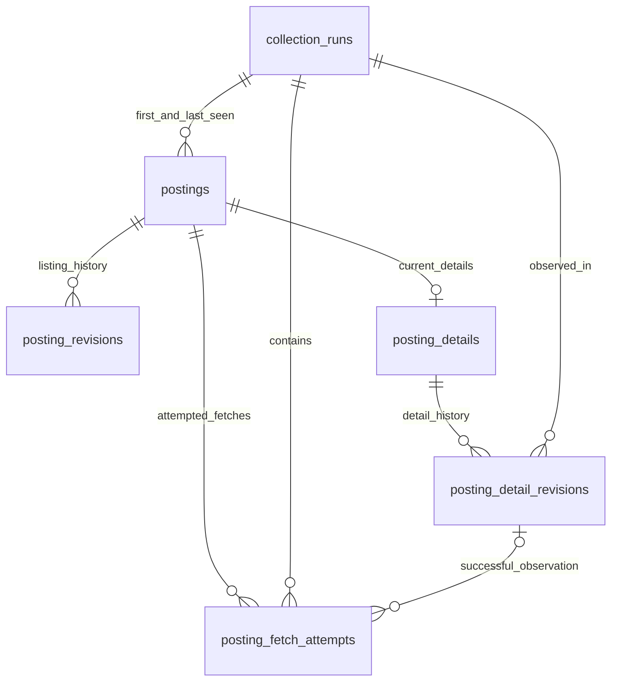

# Posting storage model

SQLite schema **v6**, local file **`data/waterlooworks.sqlite3`**. This is a storage contract, not a claim that all job content has been extracted. The file and WAL sidecars stay private and outside Git/container images.

## Identity and relationships

A `posting_id` is the observed `Id` cell normalized to a digit string. The same number always refers to the same local posting, regardless of changes to its title, employer fields, or details. Listing and detail snapshots have independent hashes and revision streams.



| Table                      | Purpose                                                                           |
| -------------------------- | --------------------------------------------------------------------------------- |
| `collection_runs`          | Existing collection status, timestamps, listing counts, and safe failure category |
| `postings`                 | Stable identity, latest listing, listing hash, first/last-seen provenance         |
| `posting_revisions`        | Append-only listing events referencing verified compact payloads                  |
| `posting_details`          | **Legacy, unused:** metadata-only detail snapshot; always empty                   |
| `posting_detail_revisions` | **Legacy, unused:** metadata-only detail history; always empty                    |
| `posting_fetch_attempts`   | **Legacy, unused:** metadata-only detail attempts; always empty                   |

> **Legacy v3 tables.** `posting_details`, `posting_detail_revisions` and `posting_fetch_attempts` are kept only so existing databases keep migrating; no runtime path writes them (the authorized backup held zero rows). Their storage APIs (`details.py`, `detail_storage.py`) were removed. Detail content is stored by the v4 `posting_contents` model below. The detail contract, hashing and attempt lifecycle sections describe that historical design, not current behavior.

No posting or detail row is created just because a request fails. A listing must already exist before its detail attempt starts. Missing results never imply deletion or inactivity.

## Legacy typed detail contract (removed)

The removed `details.py` provided strict, extra-field-forbidding Pydantic models:

```text
StoredDetail
├── id: digit string, matching the existing posting and fetch attempt
├── coverage: "metadata_only"
├── metadata: DetailMetadata (all fields required)
│   ├── title: string                 ← position
│   ├── organization: string          ← org
│   ├── division: string              ← div
│   ├── division_id: integer          ← divId
│   ├── status: string                ← status
│   ├── internal_status: string       ← internalStatus
│   └── has_prescreening: boolean     ← hasPreScreening
└── content: DetailContent
    ├── work_term: null
    ├── duration: null
    ├── description: null
    ├── responsibilities: null
    ├── qualifications: null
    ├── compensation_text: null
    ├── work_arrangement: null
    ├── location_details: null
    └── application_instructions: null
```

Metadata names/types are based on observed responses. Source-to-model mapping and extraction are not yet implemented. Status strings are preserved without inventing semantics. Listings retain openings, level, city, application count, and deadline under the existing listing model.

Content fields are **reserved and null-only in both Pydantic and SQLite**. The successful live test returned metadata and title-bearing markup, not verified complete job-description extraction. Populating these fields requires verified extraction, an updated detail contract, and a migration. Null does not mean the source lacks the information.

Raw HTML, cookies, actions, headers, application controls/state, `applicationData`, and unvalidated nested `geoData`/`tags`/`defaultLocations` are not accepted. Salary normalization and keyword analysis remain a separate future model, not fabricated source fields.

## Legacy detail hashing and revisions

- Detail payloads are fully materialized with default null content fields before hashing. Thus omitted optional content defaults and explicit nulls are equivalent in this contract.
- `sha256-json-v1` uses sorted keys and compact UTF-8 JSON, preserving string contents and JSON types. Timestamps, run/attempt IDs, and extractor versions are outside the hash.
- First successful detail observation creates the current row and a revision.
- An unchanged hash updates last-seen metadata and records a successful attempt referencing the existing revision.
- Changed content appends a revision. Returning to an earlier hash creates a new revision, not reuse of that old revision.
- Each revision records the extractor version that created it. Each successful attempt records its own extractor version, including unchanged observations. An extractor-version change alone is not a source-content revision.
- SQL triggers reject revision updates/deletes. Latest snapshot, new revision when needed, and successful attempt finalization commit together or roll back together.
- Listing changes never overwrite detail content. Failed, interrupted, malformed, or identity-mismatched detail fetches never replace a valid snapshot.

Hashes support change detection, not encryption or tamper-proof auditing. All writes should use the storage API, not ad hoc SQL.

## Legacy attempt lifecycle (removed)

```text
running → succeeded (HTTP 200, revision reference, extractor version)
        → failed (safe error category, optional HTTP status)
        → interrupted (safe category, optional HTTP status)
```

The removed `detail_storage.py` exposed:

1. `start_detail_attempt(connection, run_id, posting_id) -> attempt_id`: requires an existing posting and a running collection; records start time before network work.
2. `complete_detail_attempt(connection, attempt_id, detail, extractor_version=..., http_status=200) -> revision_id`: validates matching identity, persists the snapshot/history, and finalizes success atomically.
3. `fail_detail_attempt(connection, attempt_id, error_category, http_status=None, interrupted=False)`: changes only the attempt; preserves all valid content/history. It can finish cleanup even if the collection has already stopped.

Functions own their transactions and refuse to commit a caller's existing transaction. Terminal attempts and their identity are immutable. HTTP status and failure categories are constrained; arbitrary exception messages are never stored. A process crash leaves an identifiable `running` attempt; automatic recovery/retry is not implemented. The explicit offline `python -m waterlooworks_flash_next.refresh recover <database>` command finalizes such attempts and their run as `interrupted` (category `cancelled`) under the provider lease. Observation timestamps record persistence time, not the server's exact change time.

The caller remains responsible for network pacing, explicitly recording failures after rejected success validation, and finalizing collection counters/status. There is no automatic login, retry, fetch, or run finalization in these APIs.

## Migration and verification

`open_database(path)` transactionally upgrades v1/v2 to v3 without inventing detail history or modifying existing listing snapshots. New detail tables start empty. Foreign keys, STRICT tables, WAL, and a five-second busy timeout are enabled. Future-version databases are rejected.

Tests use generic JSON, schema introspection, real empty databases/run metadata, invalid inputs, and migration rollback checks. No posting fixtures or live authentication run in tests. Populated detail history, identity-matched success/failure cycles, and populated migration preservation have not been live-verified with real postings. Authentication → paced listings → SQLite is wired and live-verified with 1,216 listings and their initial revisions. Content-only orchestration is implemented; individual posting views remain deferred. Its live bounded refresh/SSE validation is a separate required gate.

## v5 observations and v6 compact evidence

`posting_observations` retains each newly saved posting/run membership, including unchanged listings, with immutable revision reference, ordered observation ID, timestamp and provenance. Legacy backfill represents actual revision evidence only; it never invents unchanged historical refresh membership.

In v6, `posting_revisions.listing_json` and `posting_content_revisions.content_json` are deliberately removed. Each event instead has a `payload_id` FK into immutable `history_payloads`. Its insertion trigger requires non-null matching kind/hash evidence and matching current-state provenance; update/delete triggers preserve immutability. ALTER-added payload columns are SQL-nullable for transactional backfill, but null insertion is forbidden by those triggers. Revision IDs, hashes, extractor versions, run links, observation/attempt references and current full snapshots are unchanged.

`history_payloads` stores `kind`, `content_hash`, optional earlier `base_id`, bounded dependency `depth`, versioned `encoding`, decompressed `raw_size`, and compressed BLOB `data`. `(kind, content_hash)` is unique: reversion **events** remain distinct while payload states deduplicate. A checkpoint is compressed canonical JSON. A reversible delta records before/after hashes and structural key additions/removals/replacements or linear text splices. Both directions validate input/output hashes. Missing versus null, Unicode, numeric types and negative zero retain their original canonical identity; no floating normalization is performed.

Compressed deltas are selected only when smaller than compressed checkpoints. At most 32 deltas are reconstructed; snapshots above 1 MiB always checkpoint. Decoding rejects malformed/noncanonical JSON, excessive nesting, bad hashes/patches, invalid dependencies, truncated or trailing zlib streams, and oversized payloads (64 MiB snapshot/encoded-chain, 4 MiB patch limits). The verified reader has a 16 MiB cache budget. It performs no collection or mutation.

Internal callers use `compact_history.revision_snapshot(connection, kind, revision_id)` or a shared `HistoryReader`. `observation_series` (behind `/api/postings/{id}/history`) still exposes reconstructed listing snapshots; the workspace payload no longer embeds listing revision history; current-state APIs still read full latest snapshots. Metadata-only `posting_detail_revisions` remain as an empty legacy table (the authorized backup contained zero such rows); their storage module was removed. Tests deliberately update internal schema expectations rather than preserving redundant JSON for old SQL callers.

Migration from v5 is transactional, verifies every source payload before replacing its column, preserves every revision event and incoming FK, and rolls back on corruption or unknown schema dependencies. v1–v4 upgrades chain through their original migrations first. Private actual-backup-copy acceptance checks every historical listing/content reconstruction and every delta in reverse, unchanged/reversion saves, observations/current states, FK/integrity, and real in-process GET response contracts. Default tracked tests use only generic primitives and empty schema contracts. Compaction leaves reusable free/partially filled pages; physical shrinkage requires separately authorized offline `VACUUM`, never automatic migration or GET work. Production migration and live transport verification remain separate gates.

## v4 content-only extension

The v3 metadata tables and null-only body contract above are preserved unchanged. Markup content must not fabricate metadata or masquerade as `metadata_only`. Instead v4 adds:

- `posting_contents`: current `content_only` snapshot, digit-string posting ID, reviewed plain-text `fields` map, canonical SHA-256, extractor version, first/last seen times and runs.
- `posting_content_revisions`: independent append-only history. Unchanged observations reuse the latest revision; changes and reversions append. A trigger requires inserted revisions to match the current snapshot.
- `posting_content_attempts`: pending/succeeded/failed/interrupted lifecycle, durable request/retry intent counters, HTTP/error category and matching revision FK. Terminal updates and deletions are forbidden by triggers.

All three reference existing postings/runs. Content and successful attempt completion commit atomically with the run's completed counter. Failure finalizes only its attempt, leaving previous content intact. `collection_runs` also retains detail totals/completed/requests/retries, the verification-cap marker and server `blocked_until`. Migration is transactional and leaves v3 constraints/history intact. Metadata/content unification is not implemented.

Extraction accepts observed `div > span(label) + p(value)` composition, reviewed labels, required title/organization/work-term fields, and actual descriptive content. Title and organization are checked against the requested listing. Identity is bound to the request; duplicate-title markup alone is not an independent server echo of posting ID. Unknown labels, scripts, attributes, hidden controls and active HTML are not persisted. Explicit `hidden`, `aria-hidden=true`, and supported inline display/visibility hiding suppress entire subtrees. Unsupported inline visibility expressions fail closed. External/class CSS visibility is not computed; this parser does not guarantee browser-visible text. Values remain source text, not inferred salary/location/application semantics.

## v21 description formatting

Schema v21 adds `posting_content_formatting`, kept **beside** the plain text: one current row per posting with `posting_id` (FK to `posting_contents`), the `content_hash` it was captured with (a trigger requires it to equal the current content hash), `format_version` (`rich-v1`), `blocks_json`, `captured_at` and `run_id`. `posting_contents`, its canonical hash, the `labels-text-v3` extractor version and the content revisions are unchanged, so model and deterministic projections keyed to the content hash stay valid and nothing is re-analysed. Formatting writes do bump the saved-data generation (the table is not in `EXCLUDED_TABLES`); detail reads are uncached today, so a future cached reader stays exact.

`blocks_json` maps reviewed labels to a whitelisted document tree, never HTML: `paragraph` (inline `text` runs with optional `bold`/`italic`, `link` runs with an `href`, and `break`) and `list` (`ordered` true/false) whose items are block sequences (nesting at most 4 lists deep, at most 5,000 nodes per label). Link targets must be absolute `http`/`https` URLs with a host and no user info, or a plain `mailto:` address without headers; anything else (`javascript:`, `data:`, relative, protocol-relative, whitespace/control characters, backslashes, over 2,048 characters) keeps only its text. A target containing a session value (cookie or captured form value of at least six characters) also keeps only its text. Labels whose formatting is a single unmarked paragraph, and `Targeted Degrees and Disciplines:`, store none.

The builder walks the same sanitized parse tree as the plain-text extractor, so scripts, attributes, hidden controls and blocked tags never reach it. A label keeps formatting only when its characters, ignoring whitespace, are exactly its plain text; reads repeat this check and join only the current content hash and format version. Any failure or bound overrun drops that label's formatting and never withholds the plain text. A row with an empty map records that formatting was captured but adds nothing.

Offline private-cache validation covers ten real postings, success checkpoints, unchanged revision reuse, failure preservation and FK/immutability checks. No private fixture is committed. Populated v3 metadata migration has not been live-exercised; its schema objects are verified unchanged using real empty migration databases. Process-crash recovery remains manual, never automatic resume.
