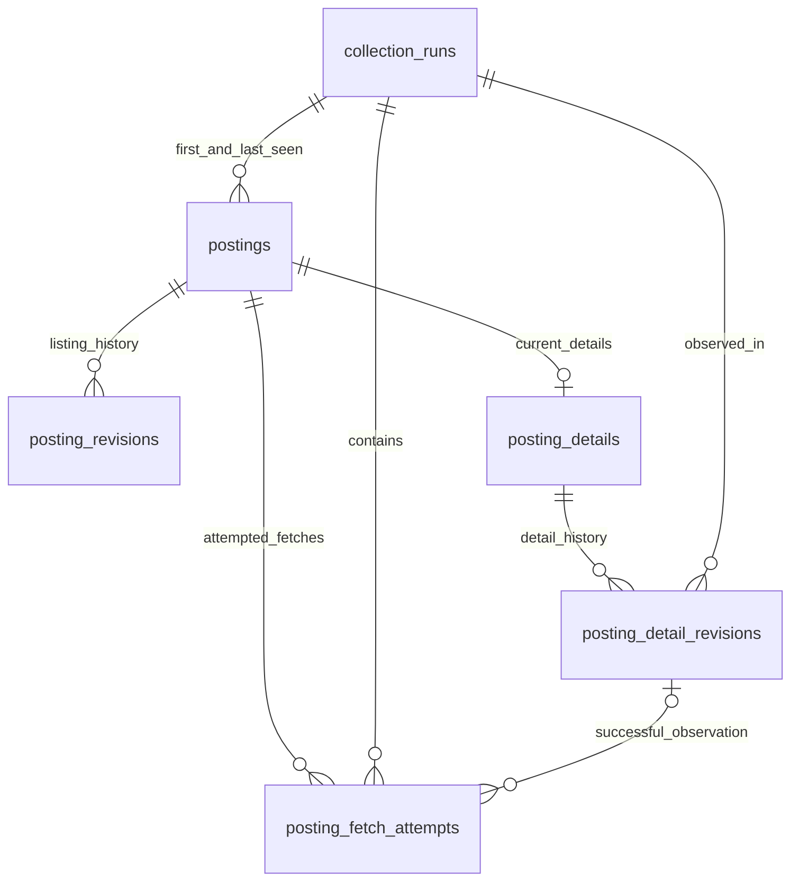

# Posting storage model

SQLite schema **v3**, local file **`data/waterlooworks.sqlite3`**. This is a storage contract, not a claim that all job content has been extracted. The file and WAL sidecars stay private and outside Git/container images.

## Identity and relationships

A `posting_id` is the observed `Id` cell normalized to a digit string. The same number always refers to the same local posting, regardless of changes to its title, employer fields, or details. Listing and detail snapshots have independent hashes and revision streams.



| Table                      | Purpose                                                                             |
| -------------------------- | ----------------------------------------------------------------------------------- |
| `collection_runs`          | Existing collection status, timestamps, listing counts, and safe failure category   |
| `postings`                 | Stable identity, latest listing, listing hash, first/last-seen provenance           |
| `posting_revisions`        | Existing append-only listing snapshots                                              |
| `posting_details`          | Latest validated detail snapshot and independent hash; absent until first success   |
| `posting_detail_revisions` | Append-only detail snapshots, hash/schema/extractor versions, run and timestamp     |
| `posting_fetch_attempts`   | Every explicitly started detail attempt, including unchanged successes and failures |

No posting or detail row is created just because a request fails. A listing must already exist before its detail attempt starts. Missing results never imply deletion or inactivity.

## Typed detail contract

`details.py` provides strict, extra-field-forbidding Pydantic models:

```text
StoredDetail
├── id: digit string, matching the existing posting and fetch attempt
├── coverage: "metadata_only"
├── metadata: DetailMetadata (all fields required)
│   ├── title: string                 ← position
│   ├── organization: string          ← org
│   ├── division: string              ← div
│   ├── division_id: integer          ← divId
│   ├── status: string                ← status
│   ├── internal_status: string       ← internalStatus
│   └── has_prescreening: boolean     ← hasPreScreening
└── content: DetailContent
    ├── work_term: null
    ├── duration: null
    ├── description: null
    ├── responsibilities: null
    ├── qualifications: null
    ├── compensation_text: null
    ├── work_arrangement: null
    ├── location_details: null
    └── application_instructions: null
```

Metadata names/types are based on observed responses. Source-to-model mapping and extraction are not yet implemented. Status strings are preserved without inventing semantics. Listings retain openings, level, city, application count, and deadline under the existing listing model.

Content fields are **reserved and null-only in both Pydantic and SQLite**. The successful live test returned metadata and title-bearing markup, not verified complete job-description extraction. Populating these fields requires verified extraction, an updated detail contract, and a migration. Null does not mean the source lacks the information.

Raw HTML, cookies, actions, headers, application controls/state, `applicationData`, and unvalidated nested `geoData`/`tags`/`defaultLocations` are not accepted. Salary normalization and keyword analysis remain a separate future model, not fabricated source fields.

## Hashing and revisions

- Detail payloads are fully materialized with default null content fields before hashing. Thus omitted optional content defaults and explicit nulls are equivalent in this contract.
- `sha256-json-v1` uses sorted keys and compact UTF-8 JSON, preserving string contents and JSON types. Timestamps, run/attempt IDs, and extractor versions are outside the hash.
- First successful detail observation creates the current row and a revision.
- An unchanged hash updates last-seen metadata and records a successful attempt referencing the existing revision.
- Changed content appends a revision. Returning to an earlier hash creates a new revision, not reuse of that old revision.
- Each revision records the extractor version that created it. Each successful attempt records its own extractor version, including unchanged observations. An extractor-version change alone is not a source-content revision.
- SQL triggers reject revision updates/deletes. Latest snapshot, new revision when needed, and successful attempt finalization commit together or roll back together.
- Listing changes never overwrite detail content. Failed, interrupted, malformed, or identity-mismatched detail fetches never replace a valid snapshot.

Hashes support change detection, not encryption or tamper-proof auditing. All writes should use the storage API, not ad hoc SQL.

## Attempt lifecycle

```text
running → succeeded (HTTP 200, revision reference, extractor version)
        → failed (safe error category, optional HTTP status)
        → interrupted (safe category, optional HTTP status)
```

`detail_storage.py` exposes:

1. `start_detail_attempt(connection, run_id, posting_id) -> attempt_id`: requires an existing posting and a running collection; records start time before network work.
2. `complete_detail_attempt(connection, attempt_id, detail, extractor_version=..., http_status=200) -> revision_id`: validates matching identity, persists the snapshot/history, and finalizes success atomically.
3. `fail_detail_attempt(connection, attempt_id, error_category, http_status=None, interrupted=False)`: changes only the attempt; preserves all valid content/history. It can finish cleanup even if the collection has already stopped.

Functions own their transactions and refuse to commit a caller's existing transaction. Terminal attempts and their identity are immutable. HTTP status and failure categories are constrained; arbitrary exception messages are never stored. A process crash leaves an identifiable `running` attempt; automatic recovery/retry is not implemented. Observation timestamps record persistence time, not the server's exact change time.

The caller remains responsible for network pacing, explicitly recording failures after rejected success validation, and finalizing collection counters/status. There is no automatic login, retry, fetch, or run finalization in these APIs.

## Migration and verification

`open_database(path)` transactionally upgrades v1/v2 to v3 without inventing detail history or modifying existing listing snapshots. New detail tables start empty. Foreign keys, STRICT tables, WAL, and a five-second busy timeout are enabled. Future-version databases are rejected.

Tests use generic JSON, schema introspection, real empty databases/run metadata, invalid inputs, and migration rollback checks. No posting fixtures or live authentication run in tests. Populated detail history, identity-matched success/failure cycles, and populated migration preservation have not been live-verified with real postings. Authentication → paced listings → SQLite is wired and live-verified with 1,216 listings and their initial revisions. Detail orchestration and individual posting views are explicitly deferred.
