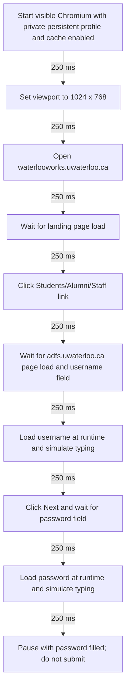

# Guided scraping workflow

## Development approach

Explore WaterlooWorks in an interactive uv-managed Python shell in `.experiment/test/`, following the user's screenshots and instructions. Promote confirmed steps into reproducible code. This is the actual platform flow, not a mock or unit test. Unit tests may cover credential-free logic; actual authentication is verified only through explicit user-directed runs.

Never view the credentials file through agent tools or expose its values. Do not collect login screenshots, traces, HTML dumps, or sensitive network details. Private experiments remain ignored.

## Playwright navigation through WaterlooWorks

Each arrow below adds **250 ms**, in addition to page readiness waits and simulated typing. This flow stops before submitting the password.



## Reproducible script

- `backend/src/waterlooworks_flash_next/login.py`: the browser flow.
- `backend/scripts/login.py`: interactive entry point; resolves the root credentials path independently of the shell's working directory.
- Secrets load dynamically only at credential-entry steps and only on the verified HTTPS authentication origin. Errors are sanitized. No login submission, session credential export, or posting retrieval is implemented.
- Chromium uses the dedicated `.experiment/browser-profile/` with normal HTTP caching and service workers enabled. Cookies and browser storage can persist between runs; HTTP cache alone does not preserve authentication. The site still controls session expiration and reauthentication.
- Treat the entire profile as sensitive authentication material: never inspect, log, commit, or copy it into a container image. It stays under ignored `.experiment/`. Close the browser gracefully with `session.close()` before rerunning; do not run two browsers against this profile concurrently.
- No authenticated session has been established by the current password-entry checkpoint. Returning-session branches are not implemented yet; if saved state changes the expected page, stop for guided exploration rather than assuming the next action.
- Typing uses approximately 33.3 ms per character: 120 words/min × 1.5 × 2 × 5 characters/word = 1,800 characters/min. Readiness waits have finite timeouts; do not use `networkidle` as a login readiness condition.

From the repository root, after backend setup and Chromium installation:

```sh
cd .experiment/test
uv run --project ../../backend --locked python -u -i ../../backend/scripts/login.py
```

On success, the shell exposes `session` and `page` while the browser remains open. The return to the Python prompt is the pause; there is no automatic submission afterward. Close with `session.close()` and then `exit()`. Do not inspect input values or dump page content. Keep `DEBUG` and `PWDEBUG` unset.

## Console logs

Stage logs use `[HH:MM:SS] [scope/LEVEL]: message` with local time and `login` or `shell` scope. Each stage logs its start and completion at INFO. DEBUG reports inter-stage delays and browser configuration, WARN marks the intentional pause, and ERROR identifies a failed stage without exception details.

Level colors: gray DEBUG, green INFO, yellow WARN, red ERROR; scope is cyan. Color is automatic in terminals. Set `FORCE_COLOR=1` for captured interactive shells, or `NO_COLOR=1` for plain text. `WW_LOG_LEVEL` supports `DEBUG`, `INFO` (default), `WARN`, and `ERROR`. Use `WW_LOG_LEVEL=DEBUG`, not Playwright's `DEBUG` or `PWDEBUG` flags.

Never log credentials, entered values, page contents, authentication URLs, or raw exceptions. The formatter omits exception/stack diagnostics but is not a secret scrubber; messages must remain non-sensitive. Logger tests are credential-free and do not run the login flow.

## Recording requirements beyond this checkpoint

**Placeholder — awaiting user instructions.**
