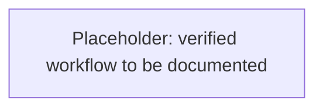

# Guided scraping workflow

## Agreed development approach

- The agent starts an interactive uv-managed Python shell in `.experiment/test/`.
- You provide screenshots and text to guide navigation through WaterlooWorks, from login to fetching information, and specify what to record along the way.
- The agent turns the verified process into a reproducible script.
- This document maintains a flowchart of Playwright’s path through WaterlooWorks as steps are confirmed—not a flowchart of the development process.

Experiments remain in the ignored `.experiment/` workspace. Credentials, session secrets, and private data must not be committed.

## Playwright navigation through WaterlooWorks

The flowchart will show verified pages or system states, Playwright actions, navigation transitions, and where information is retrieved. Any direct HTTP retrieval used along that path will be distinguished from browser actions.

**Placeholder — awaiting guided exploration. No platform steps have been verified yet.**

## Recording requirements

**Placeholder — awaiting your instructions.**

## Reproducible script

**Placeholder — to be produced from the verified process.**

No mock data or invented platform details should be added.
