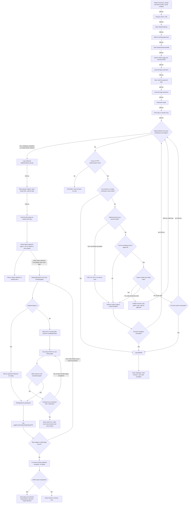

# Guided scraping workflow

## Development approach and privacy

Explore WaterlooWorks in an interactive uv-managed Python shell in `.experiment/test/`, following user instructions. This is the actual platform flow, not a mock or unit test. Unit tests cover credential-free logic only; live authentication requires explicit user direction.

Never view the obsolete credentials file, backend `.env`, private database, or sensitive form values through agent tools, expose username/password, or collect login screenshots, traces, HTML dumps, or sensitive network details. Duo codes now belong only in the ephemeral current-refresh admin status panel; never log, print, persist or include them in screenshots/artifacts. Earlier private-console handling below is historical, not current authorization.

## Historical headed-flow findings

B2 preserves the observed DOM branches but replaces console codes/process exits with a bounded memory-only admin channel and safe exceptions. Production headless SSO has not been live-validated.

- Credential entry is required again even with the saved browser profile. Browser cookies are cleared every time the login context closes (and the profile directory is forced to `0700`), so the retained profile keeps no lingering ADFS/WaterlooWorks session. Only `duosecurity.com` cookies survive, so Duo's remembered-device trust skips the Duo push on later runs until that trust expires.
- Sign in can lead to a Duo code challenge. The code may appear after the prompt; DOM-only polling successfully detected it and logged it once.
- Duo can show **Request timed out / Push timed out**. A fresh-profile run verified automatic detection, ERROR, three-second wait, browser closure, and exit 1 without retry.
- Entering a wrong code in Duo Mobile produced **Invalid verification code**, alongside **Try again** and **Other options**. The new handler was then verified on that same invalid-code page: ERROR, three-second wait, browser closure, and exit 1 without retry. It runs before code detection on every observer poll; the whole login was not repeated for this handler check.
- A fresh-profile approval run verified the complete automatic path: code detected → user approval → **Is this your device?** → **Yes, this is my device** clicked automatically → WaterlooWorks confirmed.
- On a subsequent login using that profile, credential submission reached WaterlooWorks without another manual Duo approval. The user observed a brief Duo transition; the script must not require catching that transient URL.
- The destination had **Dashboard**, **Logout / Log out**, and **Co-op** visible on `waterlooworks.uwaterloo.ca`. The script requires the HTTPS host plus Dashboard and logout controls before declaring arrival.

The challenged-login path with automatic device trust and the saved-trust path have both passed end-to-end runs. An HTTP-cache-only reset preserved device trust, while deleting the dedicated profile restored the Duo challenge. Later job-navigation branches remain placeholders.

Still not live-tested: approval without the device-trust prompt, ten checks with no code, the fixed180-second overall authentication timeout, and an unknown destination. These defensive branches are implemented, not claimed verified.

## Playwright flowchart

Navigation steps add **250 ms**. Post-submission observation runs every **500 ms**, reading only the existing DOM. Decision arrows add no extra delays.

## Branch behavior

- A returning trusted-device login can pass briefly through Duo or reach WaterlooWorks before polling sees Duo. Neither case requires a visible code or another push.
- On Duo, before a code has been seen, allow 10 unsuccessful checks at 500 ms (approximately five seconds plus DOM-query time). A code candidate must be the only visible three-digit text value while the observed verification-code prompt is visible. This conservative strategy worked live; ambiguous matches fail closed.
- Before inspecting codes or clicking device trust on each poll, check for **Invalid verification code**, **Request timed out**, or **Push timed out**. Log a fixed ERROR reason, clear the challenge, close the browser, and raise a safe exception without killing the API. No submitted code value or raw error is logged; never retry.
- Once detected, publish the code only to the current in-memory refresh channel and continue DOM-only observation while the user approves it. The earlier of the fixed overall deadline or Duo's observed failure ends the challenge. A disappearing code is not proof of success: continue observing redirects or the optional device prompt.
- **Is this your device?** is optional. When both heading and **Yes, this is my device** button are visible on the verified Duo origin, click once as user-authorized, then wait for WaterlooWorks. This action can send a trust-confirmation request; it is not a poll or a new push.
- Credential entry and known-host transitions share one fixed180-second monotonic deadline. Visible codes and device trust never reset it. Timeout or exhausted code detection clears the channel and raises a safe exception with cleanup.
- Unknown destinations fail safely. No automatic retry, reload, fetch, extra navigation, or additional Duo push is performed by polling. The page itself may perform normal background authentication requests.

## Job-board navigation

Observed manual path: **Toggle Main Menu → Co-op Jobs → View Full Cycle Service Job Board**. The resulting URL was `https://waterlooworks.uwaterloo.ca/myAccount/co-op/full/jobs.htm`, with no query or fragment. Refresh preserved the URL and visible Job Board/Search markers.

After confirmed dashboard arrival, the script now navigates directly to that observed route, waits for page load, then finds the **All Jobs** button by its accessible name and clicks it. All Jobs is a runtime action, not a URL-derived link. Each step adds 250 ms. The My Program filter is left untouched. Listing-response capture starts **before navigation**, because the initial board load already fetches the list and the All Jobs click may send no new request. After the single click, wait for outstanding board XHR/fetch activity to finish and a short 250 ms quiet interval, then reuse the latest matching response in memory. Never click again or replay page 1 just to obtain a response.

A saved-profile end-to-end rerun verified the direct dashboard-to-board shortcut and runtime All Jobs click. The browser remained open afterward for guided exploration; a later inspection identified the list POST and verified direct single-page fetches. The initial batching test completed seven pages with 350 unique postings and zero duplicates, then failed on page 8. The original sanitized error did not identify its cause. The first fresh-login retry run stopped before collection: it waited for a response after clicking All Jobs, but the listing had already loaded during navigation. A passive diagnostic confirmed the click completed and all observed board XHRs finished before it. Capture was moved before navigation and passed the next live run. That run then isolated the page-8 failure as JSON/encoding validation rather than transport.

### Single-posting retest status

The latest single-posting retest **passed** after fresh trusted-device login and page-1 capture. Two earlier attempts stopped before making detail requests because two visible anchors shared the exact same title. The successful attempt scoped the title anchor to a row containing the captured posting ID, resolving one unique target.

One title click generated two POSTs to the board route, each carrying runtime `action` and `postingId` fields:

- **HTTP 200 JSON metadata:** expected metadata keys were present and its `id` matched the selected posting.
- **HTTP 200 markup:** nonempty markup contained the selected posting title.
- **One direct Python markup replay:** HTTP 200, with the selected title present again. The opaque action and current cookies stayed in memory. Redirects were forbidden; a 2-second pause preceded the direct request, and no retry was needed.

Browser and direct markup were **not textually identical**. This verifies retrieval of title-bearing detail markup, not complete field extraction or exact response equivalence. The metadata request was not separately replayed through direct HTTP. No full-board collection, application action, export, or database write occurred. The browser closed and the private diagnostic was removed. Playwright emitted `Target closed` asynchronous cleanup warnings after the successful checks; these did not prevent the fetches but remain a cleanup caveat. At that time no reusable detail collector was implemented; see the current content-phase section below.

## Listing collection: sequential and opt-in

The observed listing request is a form-encoded POST to the job-board route with `page`, `itemsPerPage`, `sort`, `filters`, `columns`, `keyword`, `action`, and `isDataViewer`. Response content is JSON despite its HTML content type: `totalResults`, `page`, and `data`. Rows contain key/value cells, including posting ID, title, and organization. The opaque action and authenticated cookies are captured dynamically; never log, hardcode, or persist them.

Direct page 1 and page 5 requests succeeded during exploration. Page 1 counts and totals matched the captured browser response, but full record equality did not; equivalence was not claimed. Page 5 returned 50 records. The parser also validated the existing page-1 response and 50 unique IDs offline, without another network request.

A fresh-login, single-request page-8 diagnostic returned HTTP 200 and 50 records: the response was not valid UTF-8 but was valid JSON when decoded as its declared **ISO-8859-1** charset. Both browser-captured and direct responses now prefer strict UTF-8 decoding (including BOM), falling back to declared ISO-8859-1/Windows-1252 only when UTF-8 fails. No replacement characters, body logging, or charset guessing is used. JSON syntax and schema validation remain separate fail-closed checks. Codec tests contain no posting fixtures or authentication data.

The corrected fresh-login collection passed end-to-end: **25 pages, 1,216 records, 1,216 unique posting IDs, zero duplicates**. The last page contained 16 records. Page 1 was reused from browser capture; pages 2–25 were fetched sequentially, in batches of at most three with the 2-second minimum interval. No detail requests were made. Retry exhaustion and transient-retry behavior remain policy-tested rather than live-failure-tested.

Callers must perform a fresh login, capture the runtime action/cookies and page 1, then start `ListingCollection.run()` immediately. The temporary execution scripts have been removed; the reusable core does not start a collection automatically. Do not reuse an old interactive shell's request template: sessions may expire quickly. A capture older than 30 seconds is rejected before starting (a conservative guard, not a claim about actual cookie lifetime).

The captured page 1 is reused as the first completed fetch, then **one direct Python HTTP POST runs at a time**. Pages are grouped into batches of **at most three** for logging only, never fetched concurrently. Every page goes through the run's shared pacing gate (see [Conservative WaterlooWorks pacing](#conservative-waterlooworks-pacing)): a jittered **3–6 s completion-to-next-start gap** and periodic rests. The browser bootstrap itself may make its normal UI requests; those loads are counted against the caps.

Every completed page logs page/total, rows received, cumulative records, unique IDs, duplicates, and ETA. ETA is a rolling estimate from observed request durations plus the mean 4.5 s gap and amortized rests (82.5 s every 25 requests on average), assuming no further retries; it is not a guarantee. Page 1 is explicitly marked as a captured response rather than a new request.

The initial `totalResults/itemsPerPage` determines the bounded pass. If totals change, log a warning without expanding the crawl indefinitely. Deduplication uses posting ID; it cannot prevent omissions if a live list changes during pagination. Retry a page at most **twice** for network/timeouts, interrupted responses, or HTTP 408/500/502/503/504: initial attempt after the normal **2 seconds**, then retries **4 seconds** and **8 seconds** after the respective failed attempt finishes. Do not stack an extra normal delay on a retry. Stop after the third failed attempt.

Authentication failures (401/403), rate limits (429), redirects, TLS failures, invalid JSON/encoding, schema mismatches, unexpected empty pages, or a page adding no new IDs are not blindly retried. The listing collector itself makes no automatic relogin or detail requests. Logs include only safe category, page, attempt/maximum, numeric HTTP status when available, and retry decision—not exception text, response bodies, or headers.

Results remain only in `listing_collection.postings`. The collector raises a sanitized error and retains partial results in memory. Its caller must close the browser and propagate failure (a future CLI should exit nonzero). The removed runner previously implemented this boundary; the library does not terminate its caller on listing failures. Manual refresh saves the pages completed before a listing failure or shutdown stop with the same upsert-only `save_listings()` (it never infers deletion from absence), logs `Partial listing pass saved: N pages, M unique postings`, and then fails/interrupts the run without details or analysis. `complete` means the bounded page pass finished, not that the changing platform was captured atomically. A source is single-use to prevent accidental replay. There is no resume of a partial pass; the next explicit refresh starts a fresh full pass. An optional completed-pass JSON export is available; no fetched data or mock fixtures are committed. Do not print or serialize the collector or its runtime source.

## Reusable core API

Temporary launchers and execution scripts have been removed. Core modules under `backend/src/waterlooworks_flash_next/` remain:

- `login.py`: `start_login(database_path, project_root=...)` loads one authenticated-encrypted credential pair before creating the private persistent browser and entering credentials, returning a `LoginSession` at the password checkpoint.
- `duo.py`: `submit_and_observe_duo(session)` submits once and observes code/trust/failure branches until authenticated arrival or an unknown destination. **Calling it may trigger a Duo notification.** Its Duo failure handler raises a sanitized exception and closes the browser; the refresh worker clears the channel, finalizes the run and releases its provider lease.
- `jobs.py`: `open_all_jobs(session.page)` confirms authentication, navigates to the board, clicks All Jobs, and returns a fresh `ListingSource` or `None`.
- `listings.py`: construct `ListingCollection(source)` and immediately call `.run()` for paced, sequential collection. Inspect safe aggregate values such as `.pages_completed`, `.complete`, and `len(.postings)`. Catch `ListingFetchError` at the application boundary and close the session; never log raw exceptions.
- `listing_fields.py`: the allowlisted listing columns copied into saved listings.
- `logging.py`: safe stage-log formatting and logger configuration.
- `database.py`: SQLite schema v4, transactional migration, empty run creation, the `StoredListing` model, and atomic `save_listings()` upserts with SHA-256 revision history. The explicit API refresh worker now saves completed listing passes and finalizes run counters/status.
- `detail_schema.py`: legacy v3 migration that creates the empty metadata-only detail tables, kept so existing databases keep migrating. The unused `details.py`/`detail_storage.py` APIs were removed; see [the posting model](posting-model.md).

Do not auto-run these modules on import. Callers own browser cleanup through `session.close()` on completion, cancellation, or failure. Chromium uses the explicit absolute private `WW_BROWSER_PROFILE` directory; `WW_BROWSER_HEADLESS=1` is the default, and explicit `0` permits headed local operation. Sandbox is enabled and no browser/CDP/VNC port is exposed. Normal caching and service workers are enabled outside refresh; refresh blocks service workers. Cookies/storage can persist, but the site controls expiration. Do not inspect, log, commit, ship, or concurrently open the profile.

Typing is approximately **33.3 ms per character**. Credentials load only at runtime on the verified authentication origin. Keep `DEBUG` and `PWDEBUG` unset. No per-posting detail collector is implemented.

## Saved listing fields

Saved listings copy only allowlisted columns: ID, title, organization, division, openings, city, level, application count, and deadline (`listing_fields.LISTING_FIELDS`). Runtime actions, cookies, request headers, credentials, internal apply controls, and raw response objects are never persisted. The earlier private JSON export (`export.py`) had no runtime caller and was removed.

## Logs

Format: `[HH:MM:SS] [scope/LEVEL]: message`, local time, scopes `login`, `duo`, `jobs`, `listings`, `shell`. Colors: gray DEBUG, green INFO, yellow WARN, red ERROR, cyan scope. `FORCE_COLOR=1` forces color; `NO_COLOR=1` disables it. `WW_LOG_LEVEL` supports DEBUG, INFO (default), WARN, ERROR.

Only generic Duo approval guidance is logged. Codes are memory-only and admin-only via no-store `GET /api/admin/refresh-auth`; they never enter logs, console, SQLite, SSE or provider input. Never log username/password, input values, page dumps, authentication URLs, or raw exceptions.

## SQLite model and next steps

The [SQLite storage model in README](../README.md#sqlite-storage-model) defines `collection_runs`, latest-snapshot `postings`, and append-only `posting_revisions`. SHA-256 hashes of canonical allowlisted listing JSON identify changes. Repeated unchanged observations only update last-seen metadata; changes and reversions append full snapshots with run references. Timestamps record persistence time, not a claimed server-side change time. Migrated v1 snapshots become marked baselines; unavailable earlier history is not invented. Local database files live under ignored `data/`, separate from browser-profile experiments. Only allowlisted listing fields belong in the database; no runtime action/cookie/request data.

SQLite v3 adds current detail snapshots, independent append-only detail revisions, and per-posting fetch attempts. Verified metadata has a strict storage contract; unverified body fields are null-only placeholders. Failed attempts preserve valid content. One authorized API refresh populated the local database with 1,216 listings and initial listing revisions; detail tables remain empty.

Tests cover generic hashing, empty migrations/rollback, schema/model constraints, and transaction boundaries without invented postings. Initial populated listing revisions were verified; populated historical backfill and detail success/failure cycles remain unverified. Those historical checks did not cover the new content phase. Current content extraction/collection and its pending live E2E are described below; derived analysis remains deferred.

## Local API and frontend verification

Exactly one authorized live API refresh was tested: POST **202**, concurrent duplicate **409**, **34 SSE frames**, completion after **25 pages / 1,216 unique listings**, persisted listing/revision identity checks, and cooldown **429**. It made no individual detail requests. Swagger `/doc` and `/doc/openapi.json` responded successfully. API logs suppress Duo codes and raw exception text; only fixed messages and numeric progress enter SSE.

Subsequent browser checks used only the stored listings: 12-card pagination, required card fields, title search, location/organization Autocomplete, disabled unverified country, mobile layout, light/dark toggle and reload persistence, and a collapsible monospace console. The console initially follows the bottom, preserves a scrolled-up reading position, and resumes through “Jump to latest”; generic DOM tests cover appended-content follow behavior. Individual posting pages/modals/history UI are intentionally absent. Final browser checks recorded zero refresh POSTs, zero WaterlooWorks requests, and zero page errors. No containers were started.

## Current listing-to-content phase (live E2E pending)

Private authorized benchmarks verified the same ten postings across sequential/concurrent trials. A title can be an `A` element without an accessible link role. Exact visible text plus a short posting-ID ancestor resolves duplicate titles; no inferred action values are used. Offline extraction of ten cached responses found 23–29 reviewed label/value fields and stable visible text across repeats. Caches remain ignored; this document contains no posting data.

Targeted-field extraction (`labels-text-v3`) keeps only list-item text within the exact `Targeted Degrees and Disciplines:` value container, excluding button text. A narrowly scoped exception retains the observed inline `display:none` UL inside its span-label/p-value/div widget with the `Targeted Clusters` heading and associated `View Targeted Degrees and Disciplines` button. Hidden ancestors, `hidden`/`aria-hidden`, other visibility hiding, unrelated collapsed lists, navigation, and scripts remain excluded. Recorded targets may name clusters rather than specific degrees; no individual degrees are inferred.

An authorized single-posting probe observed two initial detail HTTP 200 responses and one View-button click with **zero additional HTTP requests**. The same UL/LI text was present before and after: the click changed inline display from `none` to visible, without a hidden attribute or true aria-hidden state. Seven external script GETs were blocked, none fetched. This observed variant needs no production click or additional request because its values are already in the markup; this is not a guarantee about every site variant.

Earlier offline analysis of 34 sanitized caches recovered list values but had removed original visibility attributes, leaving collapse behavior unknown at that time. The scoped live observation supersedes that uncertainty for the observed widget only; those partial caches remain unsuitable for backfill. Missing or heading/control-only saved snapshots still display “Not captured in saved content,” not “no targets,” until a future explicit manual refresh captures values. This change performs no collection, database backfill, or migration.

Refresh contexts block service workers. The approved refresh lifecycle keeps the browser open with background egress denied through complete `ListingCollection.run()` and the `save_listings()` commit. Inside the first durable detail attempt, context-wide routing then permits at most two distinct observed title-read POST forms on the exact board URL and original frame/ID. Real responses are fetched with zero implicit redirects/retries; metadata is fulfilled to dispatch dependent markup, while validated final markup is cached without rendering and its original request stays pending until browser closure. No responses or opaque actions are invented. Every actual bootstrap request intent is recorded before network access through the shared pacing gate. After sanitized markup capture the browser closes promptly; first content is reused without refetching, and remaining details use sequential direct HTTP. GET image/font/stylesheet/media/texttrack/script requests are aborted without transport or capture invalidation, even during an active fetch or after capture completion; they never enter templates, the request callback, or the ledger. Script GETs are aborted, never fetched, fulfilled, or executed by this guard. Document/navigation, xhr/fetch, and non-GET requests receive no exemption. Unexpected/duplicate/alternate detail requests, frames, forms, actions, and overlaps remain fatal; an invalid gate stays invalid. Blocked-request diagnostics contain only fixed resource/method/phase/disposition classes and per-class counts saturated at 100,000; inspection/abort failures remain fatal without exposing source values. Failure preserves saved listings/checkpoints and never automatically relogs in. A cap of 12 normally uses 13 actual requests (metadata plus markup plus 11 remaining), or 12 if markup alone suffices, excluding allowed natural retries. Bounded live verification remains required. The earlier aborted-template bootstrap failed live with only one template and is superseded.

### Description formatting backfill

Every detail capture also stores sanitized description formatting (lists, bold/italic, links, paragraphs and line breaks) beside the plain text, in schema v21 `posting_content_formatting`; the plain text, its content hash and `labels-text-v3` stay byte-identical, so saved AI and deterministic results remain valid. New postings get formatting at first capture.

Postings saved earlier lack formatting. Their saved text stays current, so the normal queue never re-fetches them; instead each refresh appends a bounded backfill **after** every never-collected or outdated posting:

- Candidates: postings in this run's listing whose saved content is from the current extractor and has no formatting for its current content hash and format version, newest first sighting first. A posting whose latest attempt failed content validation on the unchanged listing revision is skipped, like any other detail.
- Count: `min(WW_FORMAT_BACKFILL_PER_RUN, candidates, R − E − 300, P − E)`, never negative, where `R` is the rolling 24-hour budget left after this run's listing requests, `P` the per-run cap left, and `E` the queued new/outdated details plus 2 (the bootstrap's extra metadata read and a possibly already-saved visible lead). Backfill therefore never takes the rolling budget below a 300-request reserve and never trips the per-run cap; when `R − E < 300` nothing is backfilled. `WW_FORMAT_BACKFILL_PER_RUN` defaults to 20 (allowed 0–100, 0 disables; any other value stops startup with a fixed message). `WW_DETAIL_LIMIT` still caps the whole queue.
- The bootstrap still clicks a posting visible on the board's first page (`lead_with_visible`): a visible backfill posting may lead, otherwise an already-saved visible posting does.
- A backfill re-fetch is an ordinary detail request: identical text only updates the formatting row (no new content revision or hash); changed text is a normal content update with fresh formatting.
- One fixed log line reports how many saved postings were queued, how many were skipped to keep the reserve, and how many still lack formatting.

### Bounded live verification

A manually authorized cap-12 run completed on 2026-09-07 (UTC): all 25 listing pages and 1,218 unique listings were saved before detail collection, then 12 content checkpoints completed using 13 HTTP attempts (metadata plus first markup, then 11 direct markup requests), zero retries, and one burst rest. Browser bootstrap script GETs were denied without invalidating capture; no script fetch permission was added. The first content was reused and the browser closed before the remaining direct queue. Read-only SQLite checks confirmed 12 successful attempts, 12 current-content rows and matching revision links, the 13-request ledger, no foreign-key violations, and integrity `ok`.

The observer recorded one frontend refresh POST, listing-phase reload, real detail SSE events with the 12-item cap and no ETA, and terminal completion. Its subsequent UI assertion failed because HeroUI's `aria-labelledby` takes precedence over `aria-label`, so an exact accessible-name selector missed the progress bar. That selector was corrected without another collection. A separate read-only browser replay of the actual captured events verified progress values 0/3/9 of 12, unavailable ETA, expanded logs, and terminal collapse; terminal reload preserved the same completed run. This is combined live collection/storage/SSE evidence plus event-replay UI evidence, not a claim that the original observer exited successfully or sampled the active detail UI live.

This bounded result does not establish sustained platform-approved request rates or verify a full uncapped detail crawl. Private verification evidence stays under ignored `.experiment/`; neither posting content nor authentication artifacts are committed.

Superseded cadence (10-attempt bursts with sub-second pauses and 5/10/15-second retries) has been replaced by the shared conservative pacing gate below. The first-posting browser bootstrap waits for the page to dispatch each title read with a 10-second idle window that restarts whenever a paced bootstrap request settles, so a slow request using its 30-second timeout, its 3–6 s gap and one 30-second retry is not cut off; no rest is taken inside the bootstrap. Fatal/auth/429/TLS/redirect/stale failures stop with checkpoints preserved; ban-risk signals also block refreshes (1 h minimum for 429, 6 h otherwise). A posting whose own detail response fails content validation (schema, size or encoding) is recorded as a failed attempt and the pass continues with the next posting; the run still completes and OpenAI analysis covers the content that was saved. Ten consecutive item failures, or a failure during the first-posting browser bootstrap, stop the pass as a likely broken session. A posting whose latest attempt failed validation is skipped on later refreshes until its listing revision changes. Retry-After is durable (clamped to 24 hours; operators clear a stale block with `python -m waterlooworks_flash_next.rate_limit clear`, see local-api.md); there is no automatic login retry or resume; the only background starter is the opt-in scheduler (see Scheduled refresh), which uses the same single-attempt path. This cadence is not a validated platform-safe rate.

Parent verification should run one explicit refresh with server `WW_DETAIL_LIMIT=12`: full listing first, then capped content, SSE/UI stage and counter transitions, one burst boundary, terminal status and SQLite checkpoints. It must not deliberately trigger live retries/rate limits or run the default 1,000+ detail queue for testing. The implementation worker performed no live refresh.

## Conservative WaterlooWorks pacing

Every WaterlooWorks HTTP request in a refresh (listing pages, detail markup and the first-posting bootstrap metadata/markup reads) passes through one shared, strictly sequential pacing gate per run:

- **Gap:** a uniformly jittered 3–6 s wait between the completion of one request and the start of the next. Requests never overlap.
- **Rest breaks:** after every 20–30 requests (jittered) the gate rests 45–120 s; progress shows a `listing_rest`/`detail_rest` stage ("resting to stay polite to WaterlooWorks"). No rest is taken inside the two-request bootstrap.
- **Per-run cap:** `WW_REFRESH_REQUEST_CAP` (default 400, 1–2000). Reaching it stops cleanly before the network: fetched pages/details are saved, the run finishes as completed with `pacing_stop=request_cap`, and the remaining postings wait for the next refresh. Postings without saved detail content are queued first, so capped runs make progress across refreshes.
- **Rolling 24-hour cap:** `WW_REFRESH_DAILY_REQUEST_CAP` (default 1200, 1–5000), counted per run in SQLite (`collection_run_pacing`, schema v15). Sign-in and job-board browser loads are counted conservatively (4 per run). A refresh is refused with HTTP 429 and the remaining time when the budget cannot cover a run; a running refresh stops cleanly with `pacing_stop=daily_cap`.
- **Minimum interval:** `WW_REFRESH_MIN_INTERVAL_MINUTES` (default 30, 0–1440) after the previous run's finish. A scheduled slot inside it is skipped (`skipped_blocked`). An admin manual refresh inside it is not refused outright: `POST /api/refresh` with `{}` answers HTTP 409 with the fixed `X-WW-Refresh-Recent: <previous finish, UTC ISO>` header, the UI asks “Refresh again?”, and only `{"confirm_recent": true}` proceeds. Ban-risk/rate-limit blocks and the rolling budget stay hard HTTP 429 refusals with `Retry-After` that no confirmation overrides; when both apply the hard refusal wins.
- **Fail fast:** HTTP 429 stops the whole run at once (no retry) and blocks refreshes for max(Retry-After, 1 h). HTTP 401/403, a mid-run redirect to a sign-in/SSO/Duo page, or a captcha/"unusual activity"/rate-limit or sign-in page body stops at once and blocks refreshes for 6 h. These are reported as **ban-risk** stops (`pacing_stop=ban_risk`, a critical "BAN RISK" log line and an Admin settings alert). A single transient timeout/5xx is retried once after at least 30 s; if that retry fails too, the run stops and blocks for 6 h (stricter than three consecutive failures). Retries count against both caps.
- **Sign-in:** at most one login attempt per run; a failed login ends the run and never loops. The persistent browser profile is reused, but every run still performs the explicit sign-in flow (no session-reuse shortcut was added).
- **Manual or scheduled:** the admin starts a refresh, or the optional scheduler below starts one at an admin-chosen time through the exact same guarded path. Blocks are cleared only by the operator: `python -m waterlooworks_flash_next.rate_limit clear --database <path>` (stop the API first).

All three variables are server-only and validated strictly: a missing variable uses the safe default; an empty, non-integer or out-of-range value fails startup with a fixed message (never unlimited). Admin settings › Refresh shows the policy, rolling usage, next allowed refresh time, any active block and the last run's early-stop reason.

## Scheduled refresh (schema v17)

Admin settings › Schedule (admin only) holds up to 24 daily Toronto wall-clock times, shown sorted in 12-hour form, and a persisted on/off switch (off after migration). A new time must differ from every existing one by at least `WW_REFRESH_MIN_INTERVAL_MINUTES`, measured around midnight; duplicates and malformed values are refused with fixed messages that never echo input. Routes: `GET/POST/DELETE /api/admin/refresh-schedule` (`{"time":"HH:MM"}`) and `PUT /api/admin/refresh-schedule/enabled` (`{"enabled":true}`), all admin-only, no-store and behind the usual Origin/JSON/`X-WW-Request` guards.

- **Server gates:** the scheduler task runs only for the environment database with `WW_ENABLE_REFRESH=1` **and** `WW_ENABLE_SCHEDULE=1`; it is cancelled at shutdown. Without both, saved times and the switch are kept but nothing fires, and the tab says so. (The current Compose file does not pass `WW_ENABLE_SCHEDULE`; add it to the backend environment when deploying.)
- **Same protections:** about every 30 s the scheduler claims each due slot (`refresh_schedule_slots`, primary key = Toronto date + HH:MM) with one INSERT, so restarts or several workers never fire a slot twice, then calls `RefreshService.start` exactly like `POST /api/refresh`: the provider lease, shared pacing gate, per-run and rolling caps, minimum interval, ban-risk blocks and credential/AI readiness all apply; the scheduler never sends `confirm_recent`, so the minimum interval stays a hard skip for scheduled slots. A refused slot is recorded as `skipped_running`, `skipped_blocked`, `skipped_disabled` or `failed_to_start` and never retried. Each decision logs one fixed line.
- **No catch-up:** a slot fires only within 10 minutes of its time and only if it came due after scheduling was last switched on; missed slots (downtime, a disabled period) are skipped. DST: a nonexistent spring-forward time fires once at the shifted instant (02:30 → 03:30 EDT); a repeated fall-back time fires once, at its first occurrence.
- **Duo:** every run performs the explicit sign-in, so a scheduled run may send a Duo push to the account owner when WaterlooWorks needs a login. Approve only pushes you expect; the code appears in Admin settings › Refresh.
- **Auto-off:** if a scheduled run fails sign-in or Duo (denied, timed out, not completed, credentials), or ends on a ban-risk signal (429, 401/403, a mid-run login/SSO/Duo redirect, a challenge page, any refresh block), the switch turns off atomically and records the run, slot and a fixed category. Ordinary skips, network/timeouts and request caps do not. The Schedule tab shows a danger alert with the latest in-memory run log; members see only "Scheduled refresh at … failed. Please ask an admin to check the log." Switching it back on clears the alert; slot history is kept.
- **Header:** everyone sees "Refreshed 3 hours ago · Next in 5 hours" (exact Toronto times in a focusable tooltip). The shared refresh snapshot exposes only `next_scheduled_at` and `scheduled_failure.failed_at` to members.
