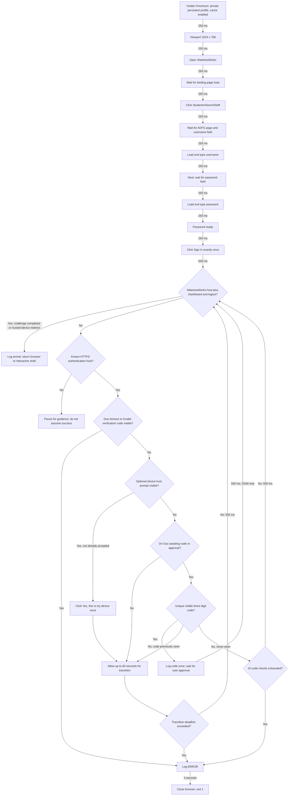

# Guided scraping workflow

## Development approach and privacy

Explore WaterlooWorks in an interactive uv-managed Python shell in `.experiment/test/`, following user instructions. This is the actual platform flow, not a mock or unit test. Unit tests cover credential-free logic only; live authentication requires explicit user direction.

Never view the credentials file through agent tools, expose username/password, or collect login screenshots, traces, HTML dumps, or sensitive network details. The user authorized printing the Duo verification code to their private console; do not share that output or commit it.

## Verified findings

- Credential entry is required again even with the saved browser profile.
- Sign in can lead to a Duo code challenge. The code may appear after the prompt; DOM-only polling successfully detected it and logged it once.
- Duo can show **Request timed out / Push timed out**. A fresh-profile run verified automatic detection, ERROR, three-second wait, browser closure, and exit 1 without retry.
- Entering a wrong code in Duo Mobile produced **Invalid verification code**, alongside **Try again** and **Other options**. The new handler was then verified on that same invalid-code page: ERROR, three-second wait, browser closure, and exit 1 without retry. It runs before code detection on every observer poll; the whole login was not repeated for this handler check.
- A fresh-profile approval run verified the complete automatic path: code detected → user approval → **Is this your device?** → **Yes, this is my device** clicked automatically → WaterlooWorks confirmed.
- On a subsequent login using that profile, credential submission reached WaterlooWorks without another manual Duo approval. The user observed a brief Duo transition; the script must not require catching that transient URL.
- The destination had **Dashboard**, **Logout / Log out**, and **Co-op** visible on `waterlooworks.uwaterloo.ca`. The script requires the HTTPS host plus Dashboard and logout controls before declaring arrival.

The challenged-login path with automatic device trust and the saved-trust path have both passed end-to-end runs. An HTTP-cache-only reset preserved device trust, while deleting the dedicated profile restored the Duo challenge. Later job-navigation branches remain placeholders.

Still not live-tested: approval without the device-trust prompt, ten checks with no code, the 60-second transition timeout, and an unknown destination. These defensive branches are implemented, not claimed verified.

## Playwright flowchart

Navigation steps add **250 ms**. Post-submission observation runs every **500 ms**, reading only the existing DOM. Decision arrows add no extra delays.



## Branch behavior

- A returning trusted-device login can pass briefly through Duo or reach WaterlooWorks before polling sees Duo. Neither case requires a visible code or another push.
- On Duo, before a code has been seen, allow 10 unsuccessful checks at 500 ms (approximately five seconds plus DOM-query time). A code candidate must be the only visible three-digit text value while the observed verification-code prompt is visible. This conservative strategy worked live; ambiguous matches fail closed.
- Before inspecting codes or clicking device trust on each poll, check for **Invalid verification code**, **Request timed out**, or **Push timed out**. Log a fixed ERROR reason, wait three seconds, close the browser, and exit 1. No submitted code value or raw error is logged; never retry.
- Once the code is detected, log it once and continue DOM-only observation while the user approves it. Duo's own timeout UI determines challenge expiry. A disappearing code is not proof of success: continue observing redirects or the optional device prompt.
- **Is this your device?** is optional. When both heading and **Yes, this is my device** button are visible on the verified Duo origin, click once as user-authorized, then wait for WaterlooWorks. This action can send a trust-confirmation request; it is not a poll or a new push.
- Known-host transitions have a 60-second bound, reset while a visible code awaits approval and after accepting device trust. Timeout or exhausted code detection closes after three seconds and exits 1.
- Unknown destinations pause for guidance. No automatic retry, reload, fetch, extra navigation, or additional Duo push is performed by polling. The page itself may perform normal background authentication requests.

## Script and local execution

- `backend/src/waterlooworks_flash_next/login.py`: persistent browser startup and credential entry; returns at the password checkpoint.
- `backend/src/waterlooworks_flash_next/duo.py`: single sign-in submission, code/trust/invalid-code/timeout branches, and WaterlooWorks arrival detection.
- `backend/scripts/login.py`: connects both parts. **Running it submits once and may trigger a Duo notification.**

Chromium uses ignored `.experiment/browser-profile/` with normal caching and service workers enabled. Cookies and browser storage can persist, but cache alone does not preserve authentication; the site controls expiration. Treat the profile as sensitive: never inspect, log, commit, copy into an image, or use it concurrently. Close with `session.close()` before rerunning.

Typing is approximately **33.3 ms per character** (360 words/min at five characters/word). Username/password load only at runtime on the verified authentication origin. No credential export or job retrieval is implemented.

From the repository root, after backend setup and Chromium installation, in a private **Git Bash** terminal:

```sh
cd .experiment/test
FORCE_COLOR=1 WW_LOG_LEVEL=DEBUG uv run --project ../../backend --locked python -u -i ../../backend/scripts/login.py
```

At confirmed WaterlooWorks arrival or an unknown destination, the interactive shell exposes `session` and `page`. Close with `session.close()` and `exit()`. Timeout and invalid-code shutdown exit 1 even with `python -i`. Keep `DEBUG` and `PWDEBUG` unset.

## Logs

Format: `[HH:MM:SS] [scope/LEVEL]: message`, local time, scopes `login`, `duo`, `shell`. Colors: gray DEBUG, green INFO, yellow WARN, red ERROR, cyan scope. `FORCE_COLOR=1` forces color; `NO_COLOR=1` disables it. `WW_LOG_LEVEL` supports DEBUG, INFO (default), WARN, ERROR.

Authorized code message: `Detected verification code: [NNN] (waiting...)`, using the detected code once. Never log username/password, input values, page dumps, authentication URLs, or raw exceptions. Keep console output private.

## Next steps

**Placeholder — job navigation and retrieval await user-guided exploration.**
